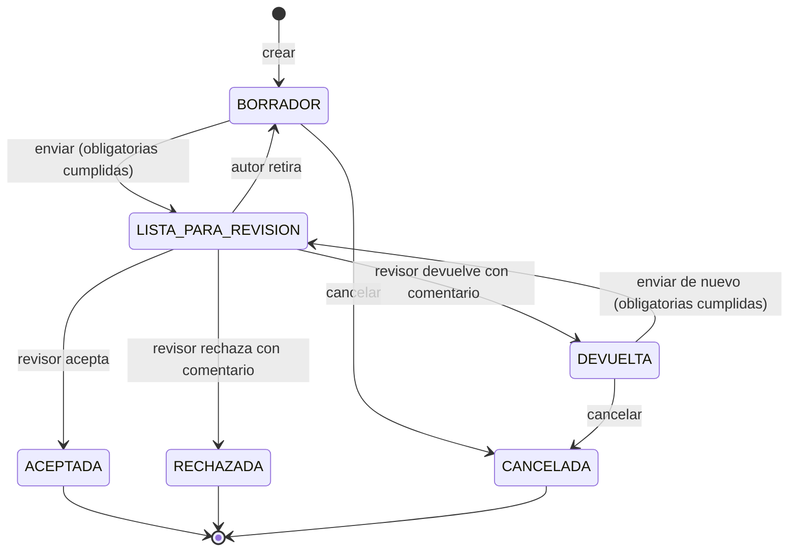
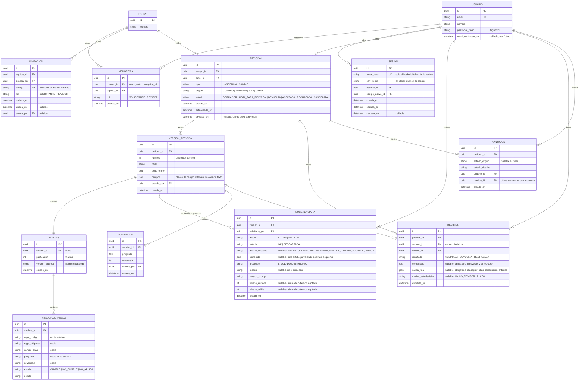
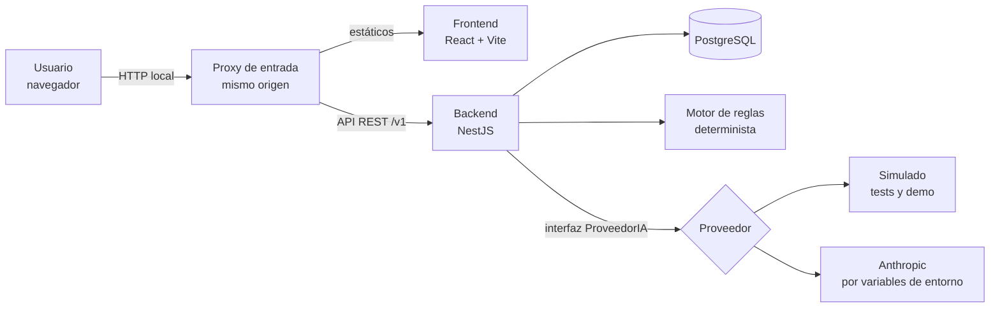

# Documento de producto — Umbral: validador y asistente de peticiones

> **Nombre del producto:** Umbral — *Unclear Messages Become Ready, Actionable and Listed*.
> **Versión:** 1.1 (base para empezar a implementar) · **Fecha:** 18 de octubre de 2026
> **Autor:** Javier (JSG) · **Contexto:** Proyecto final del Máster AI4Devs (LIDR Academy)
> **Estado:** **cerrados por el autor:** alcance, stack, catálogo de reglas de los dos tipos de petición (códigos, campos y comprobaciones), estados y transiciones, permisos, sesión y aislamiento. **Provisionales:** las severidades de las reglas (6.2 y 6.3), los valores iniciales de 6.9 (algunos marcados «a medir») y la API y el diseño detallado. **Pendientes:** modelo y esfuerzo de la IA, y cuenta, clave y presupuesto de Anthropic (sección 19).

### Historial de versiones

| Versión | Cambios |
|---|---|
| 0.1 | Primera versión del validador de peticiones |
| 0.2 | Producto neutro respecto al sector; ejemplos y reglas sin referencias a un sector concreto |
| 0.3 | Reglas definidas como datos para poder adaptar la herramienta a un sector |
| 0.4 | Las reglas pasan a configuración tipada con forma de datos, tras una interfaz (sin tablas de reglas en el MVP); `TERMINO_VAGO` como configuración; paquete compartido de esquemas; formularios dinámicos como opción primaria con alternativa de formularios fijos más test de coherencia; nombre y eslogan definitivos |
| 0.5 | Revisión de huecos: definición completa de reglas (opciones, aplicabilidad, campos más finos); especificación de las comprobaciones; ciclo de vida de estados, aclaraciones y sugerencias de IA; permisos por rol; plantillas de salida deterministas; pertenencia a equipos como relación N:M en el modelo; modelo de datos corregido (inmutabilidad, versión aceptada, título versionado, concurrencia); esbozo de API y de pantallas; decisión del proveedor de IA antes de la Entrega 1 |
| 0.6 | Decisiones del autor: un equipo por usuario en el MVP con **equipo activo en la sesión**; el solicitante ve solo sus peticiones y no hay administrador de plataforma; autoaprobación del único revisor con **salida por tiempo (7 días)** para que nada quede bloqueado; sesión con cookie y protección CSRF (alternativa aceptada: token en localStorage); aislamiento con repositorios y test que falla si hay rutas no registradas |
| 0.7 | Proveedor de IA decidido: Anthropic (API de Claude con el SDK oficial de TypeScript); plazo de autoaprobación de 7 días confirmado; valores iniciales genéricos fijados (sección 6.9); `SUGERENCIA_IA` guarda modelo y tokens |
| 1.0 | Revisión final antes de implementar: fecha de envío (`enviada_en`) para el plazo de autoaprobación; las sugerencias de IA descartadas también se guardan (coste y límites); proxy de entrada en la arquitectura; sugerencias de IA del autor solo en borrador o devuelta (la 1.1 añade el modo revisor); trabajo con pull requests en el fork; material propuesto para el README (16.1). Solo Anthropic para el MVP |
| 1.1 | Revisión crítica aplicada con las decisiones del autor: origen de la salida y formato de `salida_final`; dos modos de llamada a la IA (autor y revisor), cada uno con su esquema de objeto fijo; decisiones visibles en el detalle y aclaraciones solo en la última versión; transiciones atómicas y tabla `TRANSICION`; invitaciones de un solo uso con marcado atómico y códigos de 128 bits; `motivo_autodecision` en lugar de `autoaprobada`; el revisor solo ve peticiones enviadas alguna vez; sesión en servidor (`SESION`); validación de campos al guardar; definición de «completa»; fecha de referencia inyectada y hash del catálogo; límites y tiempos de la IA; conjunto de evaluación con campos esperados y métrica; script de medición en `scripts/spike/`; segunda dimensión del test de aislamiento; disparadores de solo añadir; presupuesto con margen y orden de recorte; correcciones mecánicas. Después, con más decisiones del autor: texto en bruto opcional (el modo autor de la IA exige texto); sesión de 8 horas desde el inicio, sin renovación; orden de recorte en seis pasos, separando coherencia, título y criterios del modo revisor de las preguntas adicionales y las aclaraciones. Tras la lectura final: token CSRF en claro en `SESION` (el de la cookie sigue solo como hash); espera de la IA de 60 s en total con reintentos incluidos y proxy con espera mayor; E2E en dos recorridos; campos y aclaraciones también como datos no confiables en 6.4; RF-21 limitado a la aceptación; límites de IA por día natural en Europe/Madrid y 429 al superarlos; contadores de límites (IA desde `SUGERENCIA_IA`, el resto en memoria). Última pasada antes de congelar el documento: la decisión indica el número de versión, como el envío (409 si ya no es la última); E2E con pasos de IA en los dos recorridos; 4.1 alineada con los datos no confiables; «hora» de los límites = últimos 60 minutos en ventana deslizante; se guarda cada llamada al proveedor (el 429 y el 400 por falta de texto no guardan nada) |

No constan versiones 0.8 ni 0.9.

---

## 1. Resumen

Herramienta web que ayuda a un equipo de desarrollo a recibir peticiones **completas**. El solicitante pega el texto en bruto de una petición (un correo, notas de una reunión, la descripción de un ticket), elige de qué tipo es y la herramienta comprueba, con **reglas deterministas**, si contiene lo que el equipo necesita para trabajar con ella. Por cada dato que falta muestra una pregunta concreta, el solicitante responde y la petición se reevalúa. Cuando está completa pasa a un revisor, que la acepta, la devuelve o la rechaza, y puede exportarla en un texto listo para pegar en Jira.

Una **IA opcional** ayuda al autor a rellenar los campos a partir del texto y a proponer preguntas, y al revisor a proponer criterios de aceptación o hipótesis. **La IA nunca decide si una petición está completa**: eso lo deciden las reglas y, al final, una persona. Sin clave de IA, la herramienta funciona rellenando los campos a mano, y la salida se compone con plantillas deterministas.

**Valor y diferenciación (criterio del autor, sin estudio de mercado):** el valor no está en que una IA critique un texto, algo que ya se puede hacer con un chat, sino en (1) un **bucle de aclaración** entre solicitante y equipo que hoy se hace por correo o reuniones, (2) reglas **explícitas y comprobables**, pensadas para poder adaptarse a cada equipo o sector más adelante, y (3) el **historial** de cómo mejora cada petición.

### 1.1 Nombre, eslogan y flujo

**Nombre:** Umbral. Una petición cruza el umbral cuando está completa y puede pasar al equipo.

**Eslogan (acrónimo en inglés):**
> **U**nclear **M**essages **B**ecome **R**eady, **A**ctionable and **L**isted
>
> *(Los mensajes poco claros pasan a estar listos, accionables y registrados en el gestor de tareas.)*

**Flujo en seis verbos (mnemónico en inglés):** cada letra de UMBRAL corresponde a un paso del producto.

| Letra | Verbo | Paso del producto | Requisitos principales |
|---|---|---|---|
| U | **U**nderstand | El solicitante pega el texto en bruto, elige el tipo y la IA propone los campos | RF-05, RF-06, RF-08 |
| M | **M**easure | Las reglas evalúan los campos y calculan la puntuación | RF-09 a RF-12 |
| B | **B**ound | Se delimita el alcance y se aplica el umbral: sin las reglas obligatorias cumplidas no se pasa a revisión | RF-19 y las reglas de alcance (RI-08, RC-08) |
| R | **R**efine | Bucle de preguntas, respuestas, devoluciones y nuevas versiones | RF-07, RF-17, RF-18, RF-34 |
| A | **A**pprove | El revisor acepta, devuelve o rechaza | RF-20, RF-21, RF-35, RF-36 |
| L | **L**aunch | Exportación en texto listo para el gestor de tareas | RF-22, RF-32 |

Limitación honesta del mnemónico: «Bound» es el paso menos nítido, porque el alcance se evalúa como una regla más dentro de «Measure» y el umbral se aplica al enviar a revisión. El mnemónico describe el flujo de forma conceptual, no una pantalla por letra.

## 2. Problema y contexto

### 2.1 El problema

En los equipos que desarrollan un producto de software llegan peticiones por varias vías (el gestor de tareas, el correo, las reuniones), con un formato desigual y con información que falta. El equipo debe pedir aclaraciones una y otra vez, las estimaciones salen mal y el trabajo empieza con una idea difusa de lo que se quiere. Todo debería acabar en la herramienta de gestión de tareas del equipo (por ejemplo, Jira), pero muchas veces el contenido llega incompleto y hay que reconstruirlo.

El problema es independiente del sector: aparece igual en el equipo de un ERP, de un comercio electrónico, de una aplicación móvil o de cualquier otro producto.

### 2.2 Ejemplos de partida

Los ejemplos siguientes son **ficticios y neutros**: describen situaciones habituales en cualquier equipo que desarrolla un producto de software, sin referirse a un sector concreto. No se usan datos reales de ninguna empresa.

**Ejemplo 1: correo que informa de una anomalía.**
> «Desde anteayer por la tarde baja cada día el número de solicitudes que se completan, mientras sube el de las que se inician. Me lo ha comentado el responsable del área.»

No es una petición de cambio: es una anomalía observada. No pide nada, no da cifras ni fechas absolutas, no indica el paso o la pantalla afectados, el dispositivo, un responsable ni la urgencia. Lo habitual al recibir un mensaje así es pedir los datos de la métrica, la comparación con días anteriores, si hubo despliegues, cambios de configuración o eventos externos en esas fechas, y cualquier dato que ayude a distinguir un fallo del producto de un cambio en el comportamiento de los usuarios.

**Ejemplo 2: ticket de Jira de un equipo de producto.**
> Título: «Botón recuperar contraseña como secundario». Descripción: «El botón de iniciar sesión sin contraseña debería ser secundario. Hoy hay dos botones al iniciar sesión y queremos que más usuarios recuperen su contraseña si no la recuerdan, para que tengan sesión iniciada; por tanto la opción de iniciar sesión sin contraseña debería ser un botón secundario.»

Está mejor planteado y explica el motivo de negocio, pero **el título contradice a la descripción** (el título habla del botón de recuperar contraseña; la descripción, del de iniciar sesión sin contraseña), no hay métrica de éxito ni criterios de aceptación, y «secundario» es ambiguo. Lo habitual al recibirlo es pedir que aclaren qué quieren hacer exactamente y un diseño de la pantalla de inicio de sesión con el botón modificado. Es un caso aplicable a cualquier sistema con un flujo de inicio de sesión, que son casi todos.

### 2.3 Qué hace la herramienta con ellos
Automatiza lo que hoy se hace a mano: pedir siempre los mismos datos, de forma consistente y sin depender de la memoria de quien revisa, y dejar constancia de cómo mejora cada petición.

## 3. Usuarios y modelo de uso

| Rol | Qué hace |
|---|---|
| **Solicitante** | Crea peticiones, completa los campos, responde las preguntas, las envía a revisión, lee el comentario si se la devuelven, y las cancela o retira |
| **Revisor** | Revisa las peticiones enviadas, pide a la IA criterios o hipótesis, edita la salida final, y las acepta, devuelve o rechaza. También puede crear peticiones propias |

- **Equipo:** conjunto de usuarios que comparten peticiones. Es la unidad de aislamiento de datos.
- **Pertenencia:** el modelo relaciona usuarios y equipos mediante una **membresía** con rol (relación N:M). En el MVP un usuario tiene como máximo una membresía; la restricción es de aplicación, no de esquema, para poder levantarla más adelante sin migrar. **La sesión lleva el equipo activo** y todo el acceso a datos parte de él, de modo que ampliar a varios equipos solo exige un selector y una ruta para cambiar de equipo.
- **Administración:** el revisor hace de administrador del equipo: ve todas las peticiones del equipo que se han enviado a revisión alguna vez, invita y decide. Un borrador que nunca se ha enviado solo lo ve su autor. No existe un administrador de plataforma que vea los datos de varios equipos.
- **Creación:** quien se registra indica su nombre y el nombre del equipo, crea así un equipo nuevo y queda como revisor. Después invita a otras personas mediante un código que lleva asociado el rol.
- **Apertura:** el producto admite varios equipos independientes.

## 4. Alcance

### 4.1 Dentro del MVP

| Área | Funcionalidad |
|---|---|
| Cuentas y equipos | Registro e inicio de sesión con nombre, email y contraseña; creación de equipo con nombre; invitación por código con rol (solicitante o revisor) |
| Entrada | Título, texto en bruto (opcional), tipo de petición (incidencia o cambio) y origen (correo, reunión, Jira, otro) |
| Campos | Campos estructurados por tipo, enlaces para diseño y datos de apoyo (**no** archivos adjuntos) |
| Relleno asistido | La IA propone al autor los campos a partir del texto, si la petición lo tiene, y al revisor criterios o hipótesis; son sugerencias editables |
| Evaluación | Reglas deterministas sobre los campos, puntuación transparente y aviso de términos vagos |
| Preguntas | Una pregunta de plantilla por cada regla no cumplida; preguntas adicionales de la IA como sugerencia, con sus respuestas guardadas como aclaraciones |
| Bucle | Respuesta del solicitante, reevaluación, devolución con comentario y versiones con historial |
| Estados | Borrador, lista para revisión, devuelta, aceptada, rechazada y cancelada, con transiciones atómicas y registradas |
| Revisión | Aceptar, devolver o rechazar (comentario obligatorio al devolver y al rechazar); edición de la salida final |
| Salida | Historia de usuario (cambio) o ticket de investigación (incidencia), compuesta con plantillas deterministas y exportable en texto compatible con Jira |
| Reglas | Catálogo único por defecto, igual para todos los equipos, escrito como **configuración tipada con forma de datos** y leído a través de una interfaz. Conjunto cerrado de tipos de comprobación. Los formularios se dibujan a partir de estas definiciones |
| Permisos | Dos roles con la matriz de la sección 6.7 |
| Seguridad | Aislamiento entre equipos y dentro del equipo, verificado por test; tratamiento del texto de la petición, los campos y las aclaraciones como datos no confiables |

### 4.2 Fuera del MVP (roadmap, no se implementa)

| Funcionalidad | Motivo |
|---|---|
| Integración directa con la API de Jira | El MVP exporta texto; conectar con Jira es una ampliación posterior |
| Archivos adjuntos | Bastan los enlaces |
| Estimación por tallas (S/M/L) | Poco fiable a partir de un texto vago; daría falsa seguridad |
| Reglas en base de datos con personalización por equipo | Se pasa de configuración a tablas cuando haga falta. No afecta al historial: cada resultado guarda una copia de la regla y los campos tienen claves estables (ver 6.4) |
| Pantalla para añadir, editar y desactivar reglas y términos vagos | Requiere las reglas en base de datos |
| Paquetes sectoriales | Conjuntos de reglas, preguntas y términos para un sector (por ejemplo, ERP o comercio electrónico) que un equipo puede activar; requieren las dos anteriores |
| Gestión de miembros (quitar, cambiar rol), pertenencia a varios equipos en la interfaz y selector de equipo | El modelo y la sesión ya lo admiten; falta la interfaz |
| Rol de administrador de equipo separado del revisor | En el MVP el revisor hace de administrador |
| Administrador de plataforma que vea varios equipos | No se contempla: contradice el aislamiento |
| Preguntas libres del revisor al solicitante | En el MVP el revisor devuelve con comentario y el autor responde editando los campos |
| Reabrir, duplicar o cambiar el tipo de una petición | Se cancela y se crea otra |
| Panel de métricas del equipo | Posible con el historial acumulado |
| Notificaciones por correo o chat | Fuera del núcleo |
| Recuperar contraseña y verificar email | Aplazable; el modelo deja los campos preparados |
| Otros tipos de petición | El MVP cubre dos tipos; el modelo admite más |
| Aprendizaje a partir del histórico del equipo | Requiere volumen de datos |

### 4.3 Neutralidad respecto al sector
El producto sirve a **equipos que desarrollan software de cualquier sector** (un ERP, un comercio electrónico, una aplicación móvil u otro producto). Por tanto, ni las reglas, ni el vocabulario por defecto, ni los ejemplos, ni los datos de prueba contienen términos propios de un sector. Las reglas hablan de «producto», «área», «grupo de usuarios» y «plataforma», no de ningún dominio concreto. Queda fuera de alcance servir a equipos que no desarrollan software.

### 4.4 Regla para decidir qué entra
Un cimiento es una decisión costosa de cambiar con datos reales ya guardados; entra en el MVP aunque sea en su versión mínima. Una funcionalidad que no cambia el modelo de datos, la seguridad ni la estructura queda fuera aunque sea útil.

## 5. Requisitos funcionales

Identificadores provisionales, pensados para la matriz de trazabilidad con los tests. Los números son estables: un requisito añadido después recibe el siguiente número libre y se coloca en su bloque temático. Por eso, dentro de cada bloque van en orden ascendente, pero los bloques no son correlativos.

### Cuenta y equipo
- **RF-01** Un visitante puede registrarse con nombre, email y contraseña, indicando el nombre de su equipo; se crean el usuario, el equipo y una membresía como revisor. Si el email ya está registrado, la respuesta es un mensaje genérico (ver 14).
- **RF-02** Un usuario puede iniciar y cerrar sesión. Cerrar sesión la invalida en el servidor.
- **RF-03** Un revisor puede generar códigos de invitación con un rol asociado (solicitante o revisor) y ver los de su equipo con su estado.
- **RF-04** Una persona sin cuenta, con un código válido, puede registrarse con nombre, email y contraseña y unirse a ese equipo con ese rol. El código se marca como usado en la misma operación y no puede usarse dos veces, aunque haya dos registros simultáneos.
- **RF-29** En el MVP un usuario tiene como máximo una membresía. El registro con invitación solo admite emails nuevos; un usuario existente no puede unirse a otro equipo en el MVP. La sesión incluye el equipo activo (al iniciar sesión, el de la membresía más antigua), y todas las consultas lo toman de ella.
- **RF-33** Un equipo siempre tiene al menos un revisor; en el MVP no se pueden quitar miembros ni cambiar roles.

### Peticiones
- **RF-05** Un usuario puede crear una petición con título (obligatorio, hasta 120 caracteres), texto en bruto (opcional, hasta 10.000 caracteres), tipo (incidencia o cambio) y origen (correo, reunión, Jira, otro). Sin texto en bruto, los campos se rellenan a mano (RF-16).
- **RF-06** El autor puede rellenar y editar los campos estructurados del tipo elegido, incluidos enlaces para diseño y datos de apoyo, mientras la petición esté en borrador o devuelta. Los campos se validan al guardar (ver 6.5).
- **RF-07** Cada vez que se guardan cambios se crea una **nueva versión** (con título, texto en bruto y campos), y las anteriores se conservan. Quien guarda indica la versión sobre la que trabaja; si ya existe una posterior, el guardado se rechaza con un conflicto. La versión solo se crea si, en ese mismo momento, la petición sigue en borrador o devuelta.
- **RF-08** El autor puede pedir a la IA, mientras la petición esté en borrador o devuelta y sobre su última versión, sugerencias de ayuda (**modo autor**, ver 7.5): relleno de los campos del tipo, preguntas adicionales, título y aviso de coherencia. El modo autor exige que la última versión tenga texto en bruto; sin él, la petición se rechaza antes de llamar al proveedor y no cuenta para los límites de uso. Cada llamada al proveedor queda guardada como sugerencia vinculada a la versión, se muestra como sugerencia editable y nunca se aplica sola; las peticiones rechazadas antes de llamarlo (429 por límite de uso, 400 por falta de texto) no guardan nada.
- **RF-30** El tipo de una petición no puede cambiarse tras crearla.

### Evaluación
- **RF-09** La aplicación evalúa cada versión con las reglas del tipo y registra el resultado de cada regla (cumple, no cumple o no aplica).
- **RF-10** La aplicación calcula una puntuación de completitud visible, a partir de las reglas obligatorias aplicables cumplidas, y muestra las recomendadas por separado. La puntuación solo se muestra: la condición para enviar a revisión es la de RF-19.
- **RF-11** La aplicación avisa de los términos vagos en los campos de texto cuando no van acompañados de una cifra en el mismo campo. El aviso no modifica la puntuación.
- **RF-12** Por cada regla que no se cumple, la aplicación muestra la pregunta de plantilla de esa regla, y conserva una copia en el resultado de la regla.
- **RF-13** La IA puede aportar al autor preguntas adicionales, una sugerencia de título y un aviso de coherencia entre título y texto, y al revisor criterios de aceptación o hipótesis (RF-35); todo se muestra marcado como sugerencia. La IA no redacta la historia ni el ticket: los compone la plantilla determinista (RF-32).
- **RF-14** La salida de la IA se valida contra el esquema de su modo de llamada; si no es válida, se descarta sin afectar a las reglas.
- **RF-15** El resultado de las reglas **no depende** de la IA.
- **RF-16** La herramienta funciona completa sin IA: los campos se rellenan a mano y la salida se compone con plantillas deterministas.

### Bucle de aclaración
- **RF-17** Para responder a una pregunta de plantilla, el solicitante rellena el campo correspondiente, lo que crea una nueva versión y reevalúa. Para responder a una pregunta adicional de la IA, escribe la respuesta, que se guarda como aclaración vinculada a la última versión, con la petición en borrador o devuelta; si la versión indicada no es la última, se rechaza con un conflicto.
- **RF-18** Se puede ver el historial de versiones de una petición con la evolución de su puntuación y de las reglas que fallaban en cada una.
- **RF-34** El autor ve en el detalle de su petición las decisiones tomadas sobre ella, con su comentario. Ante una devolución, responde editando los campos y reenviando. En el MVP el revisor no formula preguntas libres.

### Estados y revisión
- **RF-19** Una petición solo puede enviarse a revisión cuando su última versión está **completa**: ninguna regla obligatoria aplicable tiene resultado «no cumple» en el análisis guardado de esa versión. El envío indica el número de esa versión; si ya no es la última, se rechaza con un conflicto.
- **RF-20** El revisor puede aceptar (comentario opcional), devolver (comentario obligatorio; la petición pasa a «devuelta» y vuelve a ser editable) o rechazar (comentario obligatorio) una petición en lista para revisión. Un revisor no puede decidir sobre sus propias peticiones, salvo que sea el único revisor del equipo **o que hayan pasado más de 7 días desde el último envío a revisión (`enviada_en`) sin decisión**; en ambos casos la decisión guarda el motivo (`motivo_autodecision`: `UNICO_REVISOR` o `PLAZO`), sea cual sea el resultado. Así ninguna petición queda bloqueada indefinidamente. Como el envío, la decisión indica el número de la versión que el revisor ha visto; si ya no es la última (por ejemplo, porque el autor la retiró, la editó y la reenvió), se rechaza con un conflicto.
- **RF-21** Al aceptar, el revisor puede editar la salida final (título, descripción y criterios o hipótesis), partiendo de la salida compuesta por la plantilla (RF-32).
- **RF-31** El autor puede cancelar una petición en borrador o devuelta, y retirar de revisión una petición enviada, que vuelve a borrador para volver a editarla.
- **RF-35** El revisor puede pedir a la IA criterios de aceptación (cambio) o hipótesis y datos a recopilar (incidencia) sobre la última versión de una petición en lista para revisión sobre la que pueda decidir (RF-20) (**modo revisor**, ver 7.5). Se guarda como sugerencia y solo sirve de texto inicial para la salida final.
- **RF-36** Cada cambio de estado se aplica solo si la petición sigue en el estado de origen en ese momento; si no, se rechaza con un conflicto y no se registra nada. Cada cambio queda registrado en un historial de transiciones de solo añadir (estado de origen y de destino, usuario, versión y fecha).

### Salida y consulta
- **RF-22** Una petición aceptada puede exportarse como texto listo para Jira (título, descripción y criterios o hipótesis), a partir de la `salida_final` guardada en la decisión de aceptación.
- **RF-23** Cada usuario ve sus propias peticiones. Un revisor ve además las de su equipo que se han enviado a revisión alguna vez (`enviada_en` no nulo), en cualquier estado, incluidas las retiradas, devueltas y canceladas; un borrador ajeno que nunca se ha enviado no lo ve. El listado admite filtros por estado y tipo, y muestra desde cuándo espera cada petición enviada.
- **RF-24** Un usuario solo puede acceder a los datos de su propio equipo. Si pide un recurso de otro equipo, o una petición de su equipo que no puede ver (RF-23), la respuesta es siempre 404.
- **RF-32** La aplicación compone la salida (historia de usuario o ticket de investigación) con una plantilla determinista a partir de los campos de la última versión, las aclaraciones de todas las versiones y, si existen, los criterios o hipótesis de la última sugerencia válida del revisor sobre esa versión (ver 6.8).

### Definición de reglas
- **RF-25** Las reglas de cada tipo de petición se definen como configuración tipada (código, etiqueta, clave del campo, tipo de comprobación, opciones, condición de aplicabilidad, parámetros de la comprobación `noFutura` y `minCaracteres`, plantilla de pregunta y severidad) y se leen a través de una interfaz, sin que el motor conozca de dónde proceden.
- **RF-26** Todos los equipos usan el mismo catálogo por defecto (RI y RC) en el MVP.
- **RF-27** La API sirve las definiciones de reglas de un tipo, y el frontend dibuja los campos del formulario a partir de ellas, usando un componente por cada tipo de comprobación.
- **RF-28** Cada resultado de regla conserva una copia del código, la etiqueta, la clave de campo, la pregunta y la severidad vigentes en el momento del análisis, de modo que el historial no cambie si la regla se modifica después.

## 6. Reglas de negocio

### 6.1 Estados de una petición

El estado describe dónde está la petición en el flujo. Que le falten datos (reglas obligatorias sin cumplir) **no es un estado**: es una propiedad calculada del último análisis y se muestra como «con carencias» o «completa». «Con carencias» se refiere solo a reglas obligatorias; las recomendadas sin cumplir no impiden el envío.



- Se puede editar y guardar versiones solo en **borrador** y **devuelta**. En «lista para revisión» la petición es de solo lectura para el autor.
- «Aceptada», «rechazada» y «cancelada» son finales en el MVP.
- **Transiciones atómicas:** cada transición se aplica con una actualización condicionada al estado de origen (`UPDATE … WHERE id = :id AND estado = :origen`) dentro de una transacción que inserta también su fila en `TRANSICION` y, si es una decisión, en `DECISION`. Si la actualización no afecta a ninguna fila, la API responde con conflicto (409) y no se inserta nada. Guardar una versión comprueba el estado dentro de la misma transacción. Así no pueden coexistir dos decisiones sobre el mismo envío, ni un envío cruzarse con un guardado. Además, el envío y la decisión indican el número de versión y se rechazan con 409 si ya no es la última: como el estado puede volver a «lista para revisión» tras una retirada, una edición y un reenvío, comprobar solo el estado no basta para impedir una decisión sobre una versión que el revisor no vio.
- **Registro:** crear la petición registra la transición inicial (sin estado de origen) a borrador. Retirar lleva a borrador aunque la petición viniera de «devuelta»; el recorrido queda en `TRANSICION`. `enviada_en` guarda el último envío y no se borra al retirar.

### 6.2 Reglas del tipo «Incidencia o anomalía»
Pensadas para casos como el Ejemplo 1. La salida es un **borrador de ticket de investigación**. Las severidades (obligatoria o recomendada) son provisionales. Es el **catálogo por defecto**, común a todos los equipos en el MVP (ver 6.4). Cada regla define un campo (clave) y una comprobación (ver 6.5).

| Código | Regla | Campo | Comprobación | Severidad |
|---|---|---|---|---|
| RI-01 | Qué se observa: la métrica y el paso, la pantalla o la zona afectada | `observacion` | TEXTO | Obligatoria |
| RI-02 | Valor actual de la métrica | `valor_actual` | CIFRA | Obligatoria |
| RI-03 | Valor de referencia de la métrica | `valor_referencia` | CIFRA | Obligatoria |
| RI-04 | Fecha de inicio | `fecha_inicio` | FECHA_ABSOLUTA (no futura) | Obligatoria |
| RI-05 | ¿Continúa? | `continua` | OPCION (SI, NO, DESCONOCIDO) | Obligatoria |
| RI-06 | Comparativa con días o periodos anteriores | `comparativa` | TEXTO | Obligatoria |
| RI-07 | Cambios o eventos en el periodo (despliegues, cambios de configuración, eventos externos), o indicación de que se desconoce | `cambios_periodo` | TEXTO | Obligatoria |
| RI-08 | Alcance: producto, área o grupo de usuarios afectado, y plataforma o dispositivo si procede | `alcance` | TEXTO | Obligatoria |
| RI-09 | Qué se espera | `resultado_esperado` | OPCION (INVESTIGAR, CORREGIR, INFORMAR) | Obligatoria |
| RI-10 | Quién lo detectó y cómo contactarle | `detectado_por` | TEXTO | Recomendada |
| RI-11 | Urgencia con su impacto | `urgencia` | TEXTO | Recomendada |
| RI-12 | Enlace a datos de apoyo | `enlace_datos` | ENLACE | Recomendada |

### 6.3 Reglas del tipo «Cambio o mejora»
Pensadas para casos como el Ejemplo 2. La salida es una **historia de usuario** con criterios de aceptación. Es el **catálogo por defecto**, igual que el anterior, y sus severidades también son provisionales.

| Código | Regla | Campo | Comprobación | Aplica si | Severidad |
|---|---|---|---|---|---|
| RC-01 | Comportamiento actual descrito | `comportamiento_actual` | TEXTO | — | Obligatoria |
| RC-02 | Comportamiento deseado descrito: qué hacer exactamente | `comportamiento_deseado` | TEXTO | — | Obligatoria |
| RC-03 | Quién lo necesita o a quién afecta (rol o grupo de usuarios) | `actor` | TEXTO | — | Obligatoria |
| RC-04 | Motivo de negocio | `motivo` | TEXTO | — | Obligatoria |
| RC-05 | ¿Se puede medir el éxito con una cifra? | `tiene_metrica` | OPCION (SI, NO) | — | Obligatoria |
| RC-06 | Métrica de éxito con su cifra | `metrica_exito` | CIFRA | `tiene_metrica` = SI | Obligatoria |
| RC-07 | Motivo por el que no se puede medir | `motivo_sin_metrica` | TEXTO | `tiene_metrica` = NO | Obligatoria |
| RC-08 | Alcance: productos, áreas o grupos de usuarios afectados, y plataformas si procede | `alcance` | TEXTO | — | Obligatoria |
| RC-09 | ¿Afecta a la interfaz? | `afecta_interfaz` | OPCION (SI, NO) | — | Obligatoria |
| RC-10 | Referencia de diseño (enlace) | `referencia_diseno` | ENLACE | `afecta_interfaz` = SI | Obligatoria |
| RC-11 | Urgencia o fecha, con justificación | `urgencia` | TEXTO | — | Recomendada |

**Coherencia entre título y texto:** no es una regla. Es un aviso que puede aportar la IA al autor como sugerencia (ver 7.1).

Los criterios de aceptación no son una regla: los propone la IA al revisor como sugerencia (o los escribe el revisor) y el revisor los fija dentro de la salida final (ver 6.8).

### 6.4 Reglas generales
1. **Las reglas actúan sobre campos estructurados**, no sobre el texto libre. Por eso pueden comprobarse: campo relleno, cifra presente, fecha absoluta válida, enlace con formato correcto, opción válida.
2. Cada regla no cumplida muestra una **pregunta de plantilla**, con el texto fijo de la regla.
3. La **puntuación de completitud** es el cociente entre reglas obligatorias aplicables cumplidas y obligatorias aplicables, expresado como entero de 0 a 100 (redondeado al más cercano). Si no hubiera obligatorias aplicables, vale 100. Cada regla se muestra con su resultado. La puntuación **solo se muestra**. Una petición está **completa** cuando ninguna regla obligatoria aplicable tiene resultado «no cumple»; esa es la condición para enviar a revisión, no la puntuación.
4. Los **términos vagos** forman un vocabulario por defecto, común a todos los equipos en el MVP, y se avisan según el algoritmo de 6.5.
5. Una petición solo pasa a revisión si está completa (regla 3).
6. **Inmutabilidad:** las versiones, los análisis, los resultados de regla, las sugerencias de IA, las aclaraciones, las decisiones y las transiciones se añaden y **nunca se modifican ni se borran**. En una petición solo cambian su estado y las marcas de tiempo `actualizada_en` y `enviada_en`. La base de datos lo refuerza con disparadores (ver 9).
7. Un usuario solo puede leer o modificar datos de su propio equipo.
8. El texto de la petición, los campos y las aclaraciones son **datos no confiables**: nunca se interpretan como instrucciones (ver 14).
9. El idioma del MVP es el español.
10. **Las reglas se escriben como datos tipados, no como funciones sueltas.** Cada regla tiene: tipo de petición, código, etiqueta, clave del campo que define, tipo de comprobación, opciones (solo OPCION), condición de aplicabilidad, parámetros de la comprobación (`noFutura` en FECHA_ABSOLUTA y `minCaracteres` en TEXTO), plantilla de pregunta y severidad. En el MVP viven en configuración del backend y se leen a través de una interfaz.
11. **Tipos de comprobación (conjunto cerrado):** texto obligatorio, contiene una cifra, fecha absoluta, enlace válido y opción de una lista. No hay expresiones ni lenguaje de reglas.
12. **Una regla define su propio campo:** los formularios y el esquema de relleno de la IA se derivan de las definiciones, no están escritos campo a campo.
13. **En el MVP todos los equipos comparten el mismo catálogo.** No hay copia por equipo ni personalización.
14. **Condiciones para que el paso posterior a base de datos no cause problemas** (se verifican con tests): (a) los códigos de regla son únicos en todo el catálogo y las claves de campo son únicas por tipo de petición (pareja `tipoPeticion`, `campoClave`); unos y otras son estables y nunca se renombran ni se reutilizan con otro significado, lo que se comprueba comparando la lista actual con una copia guardada en el repositorio. Que `alcance` y `urgencia` existan en los dos tipos es intencionado; (b) cada resultado guarda una copia de la regla vigente, sin depender de que la regla exista en una tabla; (c) el motor accede a las reglas solo a través de la interfaz; (d) los formularios se dibujan desde las definiciones.
15. **Adaptación por sector (fuera del MVP):** un equipo de otro sector podría tener reglas distintas (por ejemplo, preguntar por el módulo afectado en un ERP o por promociones en un comercio electrónico). Requiere reglas en base de datos con personalización por equipo; no está en el MVP.
16. **Título:** forma parte de cada versión y se valida como dato de formulario (obligatorio, hasta 120 caracteres), no como regla del catálogo.
17. **Versión del catálogo:** es un hash (por ejemplo, SHA-256) del catálogo de reglas serializado de forma canónica, calculado al arrancar. Cada análisis lo guarda en `version_catalogo`, de modo que un cambio en el catálogo siempre produce una versión distinta sin depender de actualizarla a mano.

### 6.5 Especificación de las comprobaciones
Los valores numéricos son **valores iniciales** (ver 6.9) y se pueden ajustar.

| Tipo | Se cumple cuando… | Observaciones |
|---|---|---|
| TEXTO | Tras recortar espacios, tiene al menos `minCaracteres` caracteres (10 por defecto) y no es, comparado en minúsculas y sin acentos, uno de los valores de relleno de 6.9 | Con el mínimo por defecto la lista de relleno no cambia el resultado, porque todos sus valores tienen menos de 10 caracteres; sirve para reglas con un mínimo menor |
| CIFRA | Contiene al menos un número escrito con dígitos (enteros o decimales con coma o punto, con o sin %) | Los números escritos con palabras no cuentan en el MVP |
| FECHA_ABSOLUTA | Es una fecha válida en formato AAAA-MM-DD; con `noFutura`, no puede ser posterior a la fecha de referencia | Al guardar se admite también DD/MM/AAAA y se normaliza (ver validación). Expresiones como «ayer» o «anteayer» no cumplen |
| ENLACE | Es una URL válida con esquema http o https | No se comprueba que exista ni que sea accesible |
| OPCION | Su valor es una de las opciones de la definición | Las opciones tienen valor y etiqueta; se guarda el valor y las plantillas imprimen la etiqueta |

**Aplicabilidad:** si una regla tiene condición (`aplicaSi`) y no se cumple, su resultado es «no aplica» y no cuenta para la puntuación. Si el campo de la condición está vacío, la condición no se cumple.

**Fecha de referencia:** el motor es una función pura y no lee el reloj. Recibe como parámetro la fecha de referencia, que es la fecha actual en la zona horaria Europe/Madrid en el momento del análisis. Los tests la fijan.

**Validación de los campos al guardar** (backend; el frontend la repite solo para la experiencia de usuario):
- El título es obligatorio (hasta 120 caracteres). El texto en bruto es opcional (hasta 10.000 caracteres); sin él, los campos se rellenan a mano y no se puede pedir el modo autor de la IA (RF-08).
- Solo se admiten las claves de campo definidas para el tipo de la petición. Una clave desconocida rechaza el guardado (400).
- Todos los valores son texto, de hasta 2.000 caracteres, y se guardan recortados. Una cadena vacía o solo con espacios equivale a campo sin rellenar.
- OPCION: el valor debe ser uno de los valores de la definición; si no, se rechaza el guardado (400).
- FECHA_ABSOLUTA: si el valor es una fecha válida en AAAA-MM-DD o DD/MM/AAAA, se guarda normalizado en AAAA-MM-DD; si no, se guarda tal cual y la regla no se cumple, de modo que el autor ve su pregunta.
- TEXTO, CIFRA y ENLACE se guardan tal cual; las comprobaciones deciden si se cumplen. Un enlace solo se muestra como enlace si su esquema es http o https.
- Campos de reglas «no aplica»: se conservan en la versión tal como se escribieron (la versión es inmutable), pero no se evalúan, no generan avisos de términos vagos y no se imprimen en la salida.

**Términos vagos (algoritmo):** se aplican solo a los campos de tipo TEXTO de reglas aplicables, no al texto en bruto. Se comparan en minúsculas y sin acentos, por palabra o expresión completa, con el vocabulario de 6.9. Si un campo contiene un término de la lista y **no contiene ninguna cifra**, se avisa. El aviso no modifica la puntuación. Los avisos se calculan en el backend al analizar y se devuelven con el análisis; no se guardan, porque no afectan a la puntuación ni al envío.

**Limitación declarada:** las comprobaciones verifican **presencia y forma**, no la veracidad ni la calidad del contenido. Un campo con «lo antes posible, 3» pasa la comprobación de cifra. La calidad la juzga la persona que revisa, y la IA solo ayuda con sugerencias.

### 6.6 Preguntas, respuestas, aclaraciones y sugerencias
- **Preguntas de plantilla:** no son entidades propias. Son la plantilla de cada regla no cumplida en el último análisis; se muestran al autor y se guarda una copia en el resultado de esa regla. Se «responden» rellenando el campo, lo que crea una versión nueva.
- **Preguntas adicionales de la IA:** forman parte de una sugerencia del modo autor. Si el autor responde a una, la pregunta y la respuesta se guardan como **aclaración** vinculada a la última versión, con la petición en borrador o devuelta; si la versión indicada no es la última, se rechaza con un conflicto. Las aclaraciones no afectan a las reglas, y las de **todas** las versiones se incluyen en la salida.
- **Sugerencias de IA:** se piden siempre sobre la última versión. Cada llamada al proveedor crea una sugerencia nueva (nunca modifica una anterior); las peticiones rechazadas antes de llamarlo (429 por límite de uso, 400 por falta de texto) no guardan nada. Cada sugerencia guarda el modo (autor o revisor), quién la pidió, el proveedor, el modelo, la versión del prompt y los tokens. **También se guardan las descartadas** (rechazo, salida truncada o inválida, tiempo agotado, error), sin contenido y con su motivo, porque consumen tokens y cuentan para los límites de uso; si el tiempo se agota, los tokens quedan a null porque la respuesta no llega. Al pedirla, la IA recibe las aclaraciones ya existentes para no repetir preguntas; no se garantiza que no las repita, y el autor puede ignorarlas.
- **Relleno de campos:** el autor revisa la propuesta, acepta los valores que quiera y, al guardar, se crea la versión nueva con ellos.
- **Criterios e hipótesis:** los pide el revisor (modo revisor) sobre una petición en lista para revisión. La salida compuesta usa como texto inicial los de la última sugerencia válida del revisor sobre esa versión, y el revisor los edita dentro de `salida_final`. El autor no los pide ni los edita.
- **Devolución:** el comentario del revisor se muestra al autor en el detalle de la petición. El autor responde editando los campos, lo que crea una versión nueva, y reenviando. En el MVP no hay preguntas libres del revisor.
- **Fechas relativas:** si el texto dice «anteayer», la IA recibe la fecha de referencia y la zona horaria para proponer la absoluta. Es una sugerencia que el autor debe confirmar.

### 6.7 Permisos por rol
Confirmada por el autor, incluido el plazo de autoaprobación de 7 días, y actualizada en la versión 1.1.

| Acción | Solicitante | Revisor |
|---|---|---|
| Registrarse y crear equipo | Público | Público |
| Generar y ver códigos de invitación | No | Sí |
| Crear una petición | Sí | Sí |
| Ver el listado | Solo las suyas | Las suyas y las del equipo enviadas alguna vez (`enviada_en` no nulo) |
| Ver el detalle, el historial, las decisiones y la exportación | Solo de las suyas | De las suyas y de las del equipo enviadas alguna vez |
| Editar campos y guardar versiones | Sus peticiones en borrador o devueltas | Sus propias peticiones en borrador o devueltas |
| Pedir sugerencias a la IA en modo autor | Sus peticiones en borrador o devueltas, sobre la última versión, si tiene texto en bruto | Igual, sobre sus propias peticiones |
| Responder preguntas de la IA (crear aclaraciones) | Sus peticiones en borrador o devueltas, en la última versión | Igual, sobre sus propias peticiones |
| Enviar a revisión, cancelar o retirar | Autor | Autor |
| Pedir criterios o hipótesis a la IA en modo revisor | No | Peticiones en lista para revisión sobre las que puede decidir, sobre la última versión |
| Ver la salida compuesta y editar la salida final | No | Peticiones en lista para revisión sobre las que puede decidir; la edición se guarda solo al aceptar |
| Aceptar, devolver o rechazar | No | Sí, salvo sus propias peticiones; excepción: único revisor o más de 7 días desde el último envío a revisión, con `motivo_autodecision` |
| Gestionar miembros (quitar, cambiar rol) | No | No (fuera del MVP; siempre hay al menos un revisor) |

No existe un rol que vea datos de varios equipos. Un recurso que el usuario no puede ver responde siempre 404, sea de otro equipo o del propio.

### 6.8 Plantillas de salida
La salida se compone **sin IA** con estas plantillas. Los criterios de aceptación y las hipótesis son lo único que depende de la IA (modo revisor) o de lo que escriba el revisor. El formato de texto exportado (Markdown como valor por defecto) se confirmará probando el pegado en un gestor de tareas real (cuestión 3).

**Entradas del compositor:**
- Los campos de la última versión (en una petición aceptada, la versión decidida), con las opciones impresas por su etiqueta. Los campos vacíos y los de reglas «no aplica» se omiten junto con su línea.
- Las aclaraciones de **todas** las versiones, en orden de creación.
- Como texto inicial de los criterios o hipótesis, los de la última sugerencia válida del revisor sobre esa versión; si no hay, la lista empieza vacía.

**Formato de `salida_final`:** un objeto con tres partes: `titulo` (texto), `descripcion` (texto: todo lo que la plantilla pone entre la línea del título y el encabezado de criterios o hipótesis, incluidas las aclaraciones) y `criterios` (lista de textos: criterios de aceptación o hipótesis y datos a recopilar). Al aceptar se guarda siempre, editada o no; al devolver o rechazar no se guarda. La exportación une las tres partes: el título, la descripción y, al final, el encabezado («Criterios de aceptación» o «Hipótesis y datos a recopilar») con la lista.

**Historia de usuario (tipo cambio):**
```
Título: {titulo}

Como {actor}, quiero {comportamiento_deseado}, para {motivo}.

Situación actual: {comportamiento_actual}
Alcance: {alcance}
Métrica de éxito: {metrica_exito | "No medible: " + motivo_sin_metrica}
Diseño: {referencia_diseno, si aplica}
Urgencia: {urgencia, si existe}

Aclaraciones:
{pares pregunta / respuesta de todas las versiones}

Criterios de aceptación:
{propuestos por la IA al revisor o escritos por el revisor}
```

**Ticket de investigación (tipo incidencia):**
```
Título: {titulo}

Qué se observa: {observacion}
Magnitud: {valor_actual} frente a {valor_referencia}
Comparativa: {comparativa}
Desde: {fecha_inicio} (continúa: {continua})
Cambios o eventos en el periodo: {cambios_periodo}
Alcance: {alcance}
Resultado esperado: {resultado_esperado}
Detectado por: {detectado_por, si existe}
Urgencia: {urgencia, si existe}
Datos de apoyo: {enlace_datos, si existe}

Aclaraciones:
{pares pregunta / respuesta de todas las versiones}

Hipótesis y datos a recopilar:
{propuestos por la IA al revisor o escritos por el revisor}
```

### 6.9 Valores iniciales por defecto
Valores genéricos y razonables para empezar. **Se ajustan durante la implementación** si resultan inadecuados; ninguno es un compromiso de producto. Los marcados «a medir» se fijan en la comprobación inicial (sección 15).

| Ámbito | Valor inicial |
|---|---|
| Contraseña | Mínimo 10 caracteres |
| Intentos de inicio de sesión | 5 fallidos por email y dirección en 15 minutos; después, bloqueo temporal de 15 minutos |
| Intentos de registro y de códigos de invitación | 5 fallidos por dirección en 15 minutos; después, bloqueo temporal de 15 minutos |
| Duración de la sesión | 8 horas desde el inicio de sesión, sin renovación con la actividad; después hay que volver a iniciar sesión |
| Invitaciones | Caducan a los 7 días; un solo uso; código aleatorio de al menos 128 bits |
| Título | Hasta 120 caracteres |
| Texto en bruto | Hasta 10.000 caracteres |
| Campos de texto y aclaraciones | Hasta 2.000 caracteres cada uno |
| Comprobación TEXTO | Mínimo 10 caracteres (`minCaracteres`), sin valores de relleno |
| Fecha de referencia | Fecha actual en la zona horaria Europe/Madrid |
| Listado de peticiones | 20 por página |
| Autoaprobación por plazo | 7 días en «lista para revisión» |
| Sugerencias de IA | Hasta 10 intentos por usuario y hora, 100 por equipo y día y 200 por instalación y día (este último, configurable por variable de entorno). «Hora» son los últimos 60 minutos, en ventana deslizante; «día» es el día natural en Europe/Madrid. Cuentan los intentos, incluidos los descartados. Al superar un límite, la API responde 429 sin llamar al proveedor y sin guardar nada |
| Contadores de los límites | Los de la IA se calculan contando filas de `SUGERENCIA_IA`, que ya guardan cada intento. Los de inicio de sesión, registro y códigos de invitación se guardan en memoria: válido con una sola instancia del backend; se reinician al reiniciar el servidor |
| Espera máxima a la IA | 60 segundos en total por llamada, reintentos incluidos, sin streaming en el MVP. A medir |
| Reintentos del SDK (`maxRetries`) | 0 o 1, dentro de los 60 segundos totales. A medir |
| Límite de salida de la IA (`max_tokens`) | En torno a 8.000. A medir. Es un tope, no un consumo: si la salida lo alcanza queda incompleta y se descarta, y el razonamiento del modelo cuenta dentro de él |
| Esfuerzo de la IA | `low` o `medium` al empezar; se decide midiendo |
| Valores de relleno (TEXTO) | «n/a», «na», «-», «.», «?», «tbd», «xxx», «pendiente», comparados en minúsculas y sin acentos |
| Vocabulario de términos vagos | «mejorar», «mejora», «mejoras», «optimizar», «optimización», «arreglar», «arreglo», «rápido», «más rápido», «lento», «lo antes posible», «cuanto antes», «urgente», «asap», «revisar», «algunos», «varios», «a veces» |

## 7. Papel de la IA y sus límites

### 7.1 Qué hace
La IA se llama en dos modos, cada uno con su entrada y su esquema de salida (7.5).

| Modo | Tarea | Resultado |
|---|---|---|
| Autor | Relleno de campos | Sugerencia de valores a partir del texto en bruto, para los campos definidos por las reglas del tipo. Para campos con opciones, solo propone una de ellas |
| Autor | Preguntas adicionales | Preguntas de contexto que las plantillas no cubren |
| Autor | Título | Sugerencia de título |
| Autor | Coherencia | Aviso si el título y el texto se contradicen |
| Revisor | Criterios o hipótesis | Criterios de aceptación (cambio) o hipótesis y datos a recopilar (incidencia), como texto inicial de la salida final |

Todo es **sugerencia**: se muestra marcado como tal, quien la pide decide qué aceptar y nada se aplica solo.

### 7.2 Qué NO hace
- No decide si las reglas se cumplen ni la puntuación.
- No acepta ni rechaza peticiones.
- No redacta la historia ni el ticket: los compone la plantilla.
- No tiene acceso a datos de otros equipos ni a ninguna herramienta.
- No estima tallas.

### 7.3 Proveedor de IA
- **Interfaz común** con dos implementaciones: un **proveedor simulado**, determinista, para tests y demostración sin clave, y un **proveedor real** que se activa mediante variables de entorno.
- **Comportamiento del simulado:** para los textos del conjunto de evaluación (12.2), reconocidos por coincidencia exacta del texto en bruto, devuelve la respuesta preparada de cada caso; para cualquier otro texto devuelve una respuesta fija por tipo y modo, válida contra el esquema. Guarda `proveedor: SIMULADO`, sin modelo ni tokens. Permite forzar cada tipo de fallo (rechazo, salida truncada, esquema inválido, tiempo agotado, error) para los tests.
- **Etiqueta visible «Simulado»:** la interfaz marca así cada sugerencia del proveedor simulado y muestra un aviso general cuando el sistema funciona sin clave, para que nadie tome una respuesta simulada por la de un modelo.
- Los **prompts** están versionados y cada sugerencia guarda qué proveedor y qué versión del prompt se usaron.
- **Proveedor real: Anthropic**, mediante la API de Claude y el SDK oficial para TypeScript (`@anthropic-ai/sdk`). La salida se pide con el modo de salida estructurada del SDK, a partir de un esquema Zod construido con las definiciones de campos del tipo (objeto fijo, ver 7.5), y se valida de nuevo en el backend.
- **Modelo y esfuerzo:** se decidirán **midiendo** con el subconjunto de evaluación (12.2) y el script desechable de `scripts/spike/` en la comprobación inicial de la Entrega 1, comparando al menos un modelo grande y uno más barato, y comprobando qué modelos hay disponibles en ese momento. No se fijan de antemano.
- **Tiempos y reintentos:** espera máxima de 60 segundos en total por llamada, reintentos incluidos, sin streaming en el MVP; reintentos del SDK a 0 o 1; `max_tokens` en torno a 8.000. Los tres valores se miden en la comprobación inicial (6.9).
- **Credenciales:** la clave se lee de la variable de entorno `ANTHROPIC_API_KEY`; nunca se versiona. El archivo de ejemplo solo lleva un marcador. Sin clave, el sistema usa el proveedor simulado.
- **Fallos controlados:** un rechazo del modelo (`stop_reason: refusal`), una salida truncada, una salida que no cumple el esquema, un tiempo agotado, un límite de velocidad o un fallo de conexión se tratan igual: se guarda la sugerencia como descartada con su motivo, se informa de que la IA no está disponible y el flujo sigue sin ella. Con tiempo agotado, el motivo es `TIEMPO_AGOTADO` y los tokens quedan a null.
- **Trazabilidad y coste:** cada sugerencia guarda el modelo y los tokens de entrada y salida (null si el tiempo se agota), para poder medir el gasto real.

### 7.4 Controles frente a fallos y abusos
| Riesgo | Control |
|---|---|
| Respuesta con formato inválido | Validación contra esquema; si falla, se descarta y la evaluación sigue |
| Inyección de instrucciones en el texto | El texto, los campos y las aclaraciones van delimitados como datos; la IA no tiene herramientas; la salida se valida |
| Coste o abuso | Límite de longitud de entrada; límites por usuario, por equipo y global por instalación (6.9); límite de gasto en la consola del proveedor |
| Indisponibilidad del proveedor | Tiempo máximo de espera y reintentos bajos; la herramienta sigue funcionando sin IA |
| Confidencialidad | Aviso visible de que el texto se envía al proveedor; en el repositorio solo hay peticiones ficticias |
| Confusión entre simulado y real | Etiqueta visible «Simulado» en la interfaz y origen indicado en la evidencia (sección 13) |

### 7.5 Contrato de entrada y salida
**Entrada (los dos modos):** tipo de petición; título y texto en bruto de la última versión (texto hasta 10.000 caracteres; el modo autor solo se llama si hay texto, el modo revisor también sin él); definiciones de los campos del tipo (clave, etiqueta, comprobación y opciones); valores actuales de los campos; códigos de las reglas que no se cumplen en el último análisis; aclaraciones de todas las versiones; fecha de referencia y zona horaria (Europe/Madrid). Todo lo que procede de usuarios va delimitado como dato.

**Salida del modo autor:** un objeto fijo por tipo, generado a partir de las definiciones de reglas. `campos` tiene una propiedad opcional por cada clave de campo del tipo; las de tipo OPCION son una enumeración con los valores de la definición. Todas las propiedades son opcionales.

```ts
// Esbozo ilustrativo, no es código final. Modo autor, tipo CAMBIO.
// El esquema se genera desde las definiciones de reglas del tipo;
// todos los objetos llevan additionalProperties: false.
interface SalidaAutorCambio {
  campos?: {
    comportamiento_actual?: string;
    comportamiento_deseado?: string;
    actor?: string;
    motivo?: string;
    tiene_metrica?: 'SI' | 'NO';         // OPCION -> enumeración de valores
    metrica_exito?: string;
    motivo_sin_metrica?: string;
    alcance?: string;
    afecta_interfaz?: 'SI' | 'NO';
    referencia_diseno?: string;
    urgencia?: string;
  };
  preguntas?: string[];                  // preguntas adicionales
  titulo?: string;                       // sugerencia de título
  coherencia?: { hayContradiccion: boolean; explicacion?: string };
}
```

**Salida del modo revisor:** igual para los dos tipos. `criterios` es obligatoria porque es lo único que se pide.

```ts
// Esbozo ilustrativo, no es código final. Modo revisor.
interface SalidaRevisor {
  criterios: string[];   // criterios de aceptación (CAMBIO) o hipótesis y datos a recopilar (INCIDENCIA)
}
```

Reglas comunes:
- Todos los objetos del esquema llevan `additionalProperties: false`, que es lo que admite la salida estructurada del proveedor. No se usan objetos con claves libres.
- Cualquier clave desconocida, tipo erróneo u opción fuera de la lista invalida la respuesta completa, que se guarda como descartada.
- Las fechas propuestas van en AAAA-MM-DD.
- Las longitudes máximas no forman parte del esquema que se envía al proveedor; se comprueban en la validación del backend, igual que un guardado (6.5).

## 8. Requisitos no funcionales

| Ámbito | Requisito |
|---|---|
| Seguridad | Contraseñas con hash; límite de intentos; aislamiento por equipo y dentro del equipo con un mecanismo único de acceso a datos (ver 10.3); sesiones en servidor como se indica en la sección 14 |
| Privacidad | Solo se guardan los datos mínimos; aviso de envío al proveedor de IA; política de eliminación por definir |
| Fiabilidad | La evaluación por reglas es determinista y repetible con la misma fecha de referencia; el fallo de la IA no bloquea el flujo |
| Trazabilidad | Cada análisis guarda sus resultados de regla y el hash del catálogo; cada sugerencia guarda el modo, el proveedor y la versión del prompt; cada cambio de estado queda en `TRANSICION` |
| Integridad | Los datos de historial son solo de añadir, reforzado con disparadores en la base de datos (ver 9); los guardados y las transiciones concurrentes no pierden ni duplican datos |
| Mantenibilidad | API versionada; reglas y proveedor de IA desacoplados del dominio |
| Reproducibilidad | Todo el sistema arranca en local con un comando y sin clave de IA |
| Calidad | Tests unitarios, de integración y E2E; conjunto de evaluación; CI en cada cambio |

## 9. Modelo de datos (provisional)



Las **definiciones de reglas** y el **vocabulario de términos vagos** no son tablas en el MVP: viven como configuración tipada del backend (ver 6.4). Forma de cada definición:

```ts
// Esbozo ilustrativo, no es código final
interface DefinicionRegla {
  codigo: string;               // estable y único en todo el catálogo, p. ej. "RC-06"; nunca se reutiliza
  tipoPeticion: 'INCIDENCIA' | 'CAMBIO';
  etiqueta: string;
  campoClave: string;           // estable; único por tipoPeticion; clave en VERSION_PETICION.campos
  tipoComprobacion: 'TEXTO' | 'CIFRA' | 'FECHA_ABSOLUTA' | 'ENLACE' | 'OPCION';
  opciones?: { valor: string; etiqueta: string }[];          // solo OPCION
  aplicaSi?: { campoClave: string; igualA: string };          // condición de aplicabilidad
  noFutura?: boolean;           // solo FECHA_ABSOLUTA
  minCaracteres?: number;       // solo TEXTO; por defecto 10
  plantillaPregunta: string;
  severidad: 'OBLIGATORIA' | 'RECOMENDADA';
}
```

Notas del modelo:
- La **petición** (identidad y estado) está separada de sus **versiones** (contenido en cada momento), y cada versión tiene su **análisis** (uno por versión, determinista). Eso permite historial, comparación y trazabilidad. Toda petición tiene al menos una versión, creada con ella.
- **Solo de añadir:** `VERSION_PETICION`, `ANALISIS`, `RESULTADO_REGLA`, `SUGERENCIA_IA`, `ACLARACION`, `DECISION` y `TRANSICION` no se modifican ni se borran. En `PETICION` solo cambian `estado`, `actualizada_en` y `enviada_en`.
- **Refuerzo en la base de datos:** una migración crea disparadores en PostgreSQL que rechazan `UPDATE` y `DELETE` en las tablas de solo añadir, y un test de integración lo comprueba. Es **lo primero que se puede recortar** sin perder el modelo: si se recorta, la garantía queda en la capa de acceso a datos, que no ofrece métodos de modificación para esas tablas, y en su test.
- **Título versionado:** el título está en cada versión, no en la petición.
- **Concurrencia:** `numero` es único por petición. Al guardar, el cliente indica sobre qué número trabaja; si ya hay uno posterior, la API responde con un conflicto y no crea la versión. Las transiciones de estado son atómicas (ver 6.1).
- **Pertenencia:** `MEMBRESIA` relaciona usuario y equipo con un rol. El esquema admite varias por usuario, con la pareja (`usuario_id`, `equipo_id`) única; el MVP aplica una por usuario (RF-29).
- **Sesión:** `SESION` guarda el hash del token de la cookie (nunca el token), el token CSRF en claro para poder entregarlo de nuevo tras recargar la página (ver 14), el equipo activo y la caducidad. Cerrar sesión rellena `cerrada_en`. No es una tabla de historial: no está entre las de solo añadir.
- **Invitación:** al registrarse con un código, `usada_en` y `usada_por` se rellenan con `UPDATE … WHERE codigo = :codigo AND usada_en IS NULL AND caduca_en > ahora`, en la misma transacción que crea el usuario y la membresía; si no afecta a ninguna fila, el registro falla.
- **Decisión:** referencia la versión decidida. Al aceptar guarda siempre `salida_final`, que es lo que se exporta. `motivo_autodecision` es nulo salvo cuando el revisor decide sobre su propia petición.
- **Sugerencia:** `solicitada_por` permite aplicar los límites por usuario, y `modo` distingue las peticiones del autor y del revisor.
- Las preguntas de plantilla **no son una tabla**: son `RESULTADO_REGLA.pregunta` de las reglas no cumplidas. Las respuestas a preguntas de la IA se guardan en `ACLARACION`.
- `RESULTADO_REGLA` guarda una **copia** de los datos de la regla en el momento del análisis y **no tiene clave foránea** hacia ninguna regla. Así el historial es autónomo, y el paso futuro a una tabla `REGLA` por equipo no obliga a migrar resultados antiguos.
- Los valores de `campos` usan las claves de campo estables de las definiciones de reglas y son siempre texto (ver la validación de 6.5). Si en el diseño detallado el JSON resulta limitante, se pasará a tablas.
- Todas las entidades de negocio llevan `equipo_id`, directa o indirectamente, para imponer el aislamiento.
- Los nombres de campos y entidades están por fijar en el diseño detallado.

## 10. Arquitectura

### 10.1 Vista general



### 10.2 Componentes

| Componente | Responsabilidad |
|---|---|
| Proxy de entrada | Sirve el frontend y reenvía las llamadas de la API, de modo que navegador, frontend y API comparten origen (necesario para la cookie de sesión; no se habilita CORS). Escribe la dirección del cliente en `X-Forwarded-For`; el backend solo confía en esa cabecera cuando la petición llega del proxy. Su tiempo de espera hacia el backend es mayor que la espera total de la IA (por ejemplo, 90 s frente a 60 s), para no cortar con un 504 una respuesta que el backend aún está guardando |
| Frontend (React + Vite) | Alta de peticiones, campos, reglas y puntuación, sugerencias, historial, revisión y exportación |
| Backend (NestJS) | API, autenticación, sesiones, permisos por rol, aislamiento por equipo, flujo de estados |
| Motor de reglas | Interpreta las definiciones de reglas (configuración tipada leída por una interfaz) y evalúa los campos de cada versión con una fecha de referencia recibida como parámetro; no depende de la IA, de la red ni del reloj |
| Compositor de salida | Compone la historia o el ticket con las plantillas de 6.8 |
| Paquete compartido | Esquemas de campos y de la salida de la IA, y tipos comunes; lo usan backend y frontend para no duplicar la validación |
| Servicio de IA | Construye la petición al proveedor en el modo que corresponde, valida la salida contra su esquema, aplica límites (usuario, equipo y global), tiempos y reintentos |
| Proveedor de IA | Interfaz con implementaciones simulada y real |
| Base de datos (PostgreSQL + Prisma) | Persistencia, migraciones versionadas y disparadores de solo añadir |

### 10.3 Decisiones de arquitectura
- Backend modular por dominio (cuentas, equipos, peticiones, reglas, análisis, revisión, exportación), con capas controlador → servicio → acceso a datos.
- El **motor de reglas es una función pura** sobre los campos, las definiciones de reglas y la fecha de referencia: facilita los tests y evita que la IA, la red o el reloj influyan en el resultado.
- Las **reglas tienen forma de datos** (conjunto cerrado de tipos de comprobación) y el motor las lee **solo a través de una interfaz**. En el MVP la implementación lee configuración; más adelante podrá leer una tabla por equipo sin cambiar el motor.
- Los **formularios del frontend se dibujan desde las definiciones** de reglas servidas por la API, con un componente por tipo de comprobación.
- **Una sola fuente de validación:** un paquete compartido con los esquemas de campos y de la salida de la IA, en un repositorio único con paquetes de backend, frontend y compartido. La validación del frontend es solo para la experiencia de usuario; la del backend es la que manda.
- El **proveedor de IA es una interfaz**; el dominio no sabe cuál se usa.
- **Aislamiento (decidido):** el acceso a datos se hace mediante repositorios que exigen un contexto de equipo en su firma, de modo que no se pueden llamar sin él, y ese contexto sale del **equipo activo de la sesión**. Un test recorre todos los endpoints y comprueba que ninguno devuelve ni modifica datos de otro equipo; **ese test falla si existe una ruta que no esté registrada en él**, para que un endpoint nuevo no pueda saltarse la comprobación. Incluye un caso con un usuario de dos membresías creado directamente en la base de datos. Una **segunda dimensión** del mismo test comprueba, en todas las rutas con identificador de petición, que un solicitante no accede a una petición de otro solicitante del mismo equipo, ni un revisor a un borrador ajeno que nunca se ha enviado. En todos los casos la respuesta es 404. Como defensa adicional opcional, se podría añadir seguridad a nivel de fila en PostgreSQL.
- **Transiciones atómicas:** todo cambio de estado sigue el patrón de 6.1.
- La evaluación se ejecuta de forma síncrona al guardar una versión; las sugerencias de IA se piden aparte, bajo demanda, con tiempo máximo.

### 10.4 Esbozo de API
Rutas bajo `/v1`. Es un esbozo para dimensionar el backend; **el README documenta solo tres** (cuestión 13). Errores comunes: 404 para todo recurso que el usuario no puede ver, sea de otro equipo o del propio; 409 para conflictos de versión o de estado; 429 al superar un límite de uso de la IA, sin llamar al proveedor y sin guardar nada (6.9).

| Método y ruta | Qué hace |
|---|---|
| `POST /auth/registro` | Crea usuario (nombre, email, contraseña), equipo (nombre) y membresía de revisor |
| `POST /auth/registro-invitado` | Crea usuario y membresía con un código de invitación, y marca el código como usado en la misma transacción |
| `POST /auth/login`, `POST /auth/logout`, `GET /auth/yo` | Sesión en servidor; `yo` devuelve el usuario, el equipo activo, el rol y el token CSRF, leído de la sesión, de modo que el frontend lo recupera también tras recargar la página |
| `POST /equipo/invitaciones`, `GET /equipo/invitaciones` | Genera un código y lista los del equipo con su estado (revisor) |
| `GET /reglas?tipo=` | Definiciones de reglas de un tipo |
| `GET /peticiones?estado=&tipo=` | Listado según permisos (RF-23) |
| `POST /peticiones` | Crea la petición con la primera versión y su análisis |
| `GET /peticiones/:id` | Detalle con última versión, análisis (con avisos de términos vagos), sugerencias, aclaraciones, decisiones y transiciones |
| `POST /peticiones/:id/versiones` | Guarda una versión nueva (con el número base) y la evalúa |
| `GET /peticiones/:id/versiones` y `/versiones/:n` | Historial |
| `POST /peticiones/:id/versiones/:n/sugerencias` | Pide sugerencias a la IA. `:n` debe ser la última versión (si no, 409). El modo sale del estado y del rol: autor en borrador o devuelta; revisor que puede decidir en lista para revisión; cualquier otro caso se rechaza. El modo autor sin texto en bruto se rechaza (400) sin llamar al proveedor. Si se supera un límite de uso, 429 sin llamar al proveedor y sin guardar nada |
| `POST /peticiones/:id/versiones/:n/aclaraciones` | Guarda una aclaración. `:n` debe ser la última versión (si no, 409) |
| `POST /peticiones/:id/envio`, `/retirada`, `/cancelacion` | Cambios de estado del autor; el envío indica el número de la última versión |
| `GET /peticiones/:id/salida` | Vista previa de la salida compuesta (revisor, en lista para revisión), con el número de la versión a partir de la que se compone, que el revisor devuelve al decidir |
| `POST /peticiones/:id/decision` | Aceptar, devolver o rechazar (revisor), con el número de la versión vista (si ya no es la última, 409), comentario y, al aceptar, `salida_final` |
| `GET /peticiones/:id/exportacion` | Texto exportable de una petición aceptada |

### 10.5 Mapa de pantallas
1. **Acceso:** registro (nombre, email, contraseña y nombre del equipo), inicio de sesión y registro con código de invitación.
2. **Listado de peticiones:** filtros por estado y tipo; indicador «con carencias» o «completa».
3. **Nueva petición:** título, tipo, origen y texto en bruto (opcional).
4. **Detalle y edición:** formulario dinámico por campos, panel de reglas con su resultado y puntuación, avisos de términos vagos, sugerencias de la IA (aceptar o ignorar, con la etiqueta «Simulado» cuando proceda), aclaraciones, decisiones con su comentario, y botones de guardar, enviar, retirar o cancelar.
5. **Historial de versiones:** evolución de la puntuación y de las reglas que fallaban.
6. **Revisión:** salida compuesta, petición de criterios o hipótesis a la IA, edición de la salida final (título, descripción y criterios o hipótesis) y decisión con comentario.
7. **Exportación:** texto listo para copiar.
8. **Invitaciones** (revisor): generar y ver códigos.

## 11. Stack tecnológico

| Capa | Tecnología | Motivo |
|---|---|---|
| Lenguaje | TypeScript en todo el proyecto | Un solo lenguaje; los tipos detectan errores del código generado por IA |
| Frontend | React + Vite | Estándar de mercado; mucho código de referencia |
| Backend | NestJS (Node) | Estructura modular y capas claras |
| Base de datos | PostgreSQL | Relacional, integridad referencial, soporte de JSON |
| ORM y migraciones | Prisma | Esquema declarativo y migraciones versionadas |
| Estructura del repositorio | Repositorio único (monorepo) con paquetes de backend, frontend y compartido | Esquemas y tipos en un solo sitio |
| Validación | Librería de esquemas tipados (por ejemplo, Zod) en el paquete compartido, para los campos y la salida de la IA | Reglas y respuestas comprobables; backend y frontend no duplican esquemas |
| Tests unitarios | Vitest o Jest | Rapidez y soporte de TypeScript |
| Tests de integración | Supertest sobre la API con base de datos de prueba | Prueba el ciclo petición → base de datos |
| Tests E2E | Playwright | Recorre el flujo real en navegador |
| Contenedores | Docker Compose | Mismo arranque en cualquier máquina |
| CI | GitHub Actions | Ejecuta los tests en cada cambio |
| IA | Proveedor simulado y proveedor real (Anthropic, SDK oficial de TypeScript) | Tests y demostración sin clave; el real es opcional |
| Desarrollo con IA | Claude Code y subagentes, con `CLAUDE.md` y hooks | Práctica del máster; los prompts se registran en `prompts.md` |

Las versiones concretas se fijarán al iniciar el repositorio.

## 12. Estrategia de pruebas, evaluación y CI

### 12.1 Niveles de prueba

| Nivel | Qué cubre | Ejemplos |
|---|---|---|
| Unitarios | Motor de reglas, comprobaciones, validación de campos, estados y composición de salida | Cada tipo de comprobación con casos que cumplen y no cumplen (6.5), incluida `noFutura` con la fecha de referencia fijada; reglas condicionales («no aplica»); cada regla del catálogo por defecto (RI y RC); el motor funciona igual con una fuente de reglas en memoria distinta de la de configuración (depende solo de la interfaz); los códigos de regla son únicos en todo el catálogo, las claves de campo son únicas por (`tipoPeticion`, `campoClave`) y ambos coinciden con la copia guardada en el repositorio (estabilidad); el hash del catálogo cambia si cambia el catálogo; validación al guardar (clave desconocida, OPCION inválida, normalización de fecha, cadena vacía); términos vagos con y sin cifra; cálculo de la puntuación y su caso límite, y la condición de «completa»; cada transición de estado permitida y cada prohibida; matriz de permisos; autoaprobación con su `motivo_autodecision` (único revisor, y por plazo de 7 días con un reloj inyectable en el test, sin esperar); las plantillas de salida producen el texto esperado sin IA, con etiquetas de OPCION, sin campos «no aplica» y con las aclaraciones de todas las versiones; validación de los esquemas de los dos modos de la IA, incluida clave desconocida y opción fuera de lista |
| Integración | API + base de datos real de prueba | Registro (con nombre de usuario y de equipo) e invitación con rol; un código usado en dos registros simultáneos solo prospera una vez; límite de intentos de registro y de códigos; registro con email existente (mensaje genérico); restricción de una membresía por usuario; sesión en servidor: inicio, cierre que la invalida, caducidad a las 8 horas aunque haya actividad (con reloj inyectable) y equipo activo igual a la membresía más antigua; protección CSRF (una petición que modifica datos sin token, o con el de otra sesión, se rechaza; `GET /auth/yo` devuelve el mismo token en llamadas sucesivas de la misma sesión); límite de intentos por dirección detrás del proxy; la API sirve las definiciones de reglas; versionado y conflicto de versión concurrente; transiciones concurrentes: dos decisiones simultáneas producen una decisión y un 409, y un envío cruzado con un guardado no deja en revisión una versión incompleta; retirar, editar y reenviar entre la lectura y la decisión da 409; cada transición deja su fila en `TRANSICION`; datos solo de añadir: los disparadores rechazan `UPDATE` y `DELETE` (si se recortan, se comprueba que no hay métodos de modificación); cada resultado guarda la copia de la regla y no depende de ninguna tabla de reglas; flujo de estados con permisos; sugerencias y aclaraciones sobre una versión que no es la última dan 409; una petición sin texto en bruto se crea y se completa a mano, y el modo autor de la IA sobre ella se rechaza sin contar para los límites; **aislamiento entre equipos en todos los endpoints**, que falla si hay una ruta sin registrar, y con un usuario de dos membresías; **segunda dimensión** dentro del equipo (solicitante sobre petición ajena, revisor sobre borrador nunca enviado), siempre 404; el equipo activo de la sesión determina los datos; el fallo de la IA no bloquea el flujo, incluido el tiempo agotado (descartada con `TIEMPO_AGOTADO` y tokens a null); límites de IA por usuario, por equipo y global, contados desde `SUGERENCIA_IA` en los últimos 60 minutos y por día natural en Europe/Madrid (con reloj inyectable), con 429 al superarlos sin llamar al proveedor ni guardar sugerencia; la exportación usa la `salida_final` de la aceptación |
| E2E | Flujo completo en navegador, en dos recorridos con equipos distintos | (a) **Equipo con un solo revisor:** registrarse → pegar una petición → ver reglas fallidas y preguntas → pedir sugerencias a la IA (modo autor) → rellenar campos → enviar a revisión → aceptar como único revisor (`motivo_autodecision` = `UNICO_REVISOR`) → exportar. (b) **Equipo con dos revisores:** el fundador invita a un segundo revisor → el fundador crea una petición, la completa y la envía → el segundo revisor la devuelve con comentario → el autor ve el comentario, corrige y reenvía → el segundo revisor pide criterios a la IA (modo revisor) → el segundo revisor la acepta → exportar. En ambos, la etiqueta «Simulado» es visible en las sugerencias |

**Alternativa de sesión:** si se activa la alternativa de la sección 14 (token de sesión en `localStorage`), las pruebas de CSRF se sustituyen por pruebas de la cabecera `Authorization`; las de inicio, cierre y caducidad no cambian.

**Test condicional de coherencia (solo si los formularios pasan a ser fijos):** comprueba, usando el paquete compartido, que cada clave de campo de las definiciones de reglas tiene su campo en el formulario correspondiente y que no hay campos de formulario sin definición. Con formularios dinámicos no hace falta, porque el formulario se deriva de las definiciones y no puede desajustarse.

### 12.2 Conjunto de evaluación
Entre 10 y 15 peticiones **ficticias pero realistas**, de los dos tipos. Cada caso guarda el texto en bruto, el tipo, los **valores de campo esperados** y el resultado esperado de cada regla con esos valores. Incluye los Ejemplos 1 y 2.

- **Subconjunto de la Entrega 1:** los Ejemplos 1 y 2 más 3 o 4 casos, con sus campos esperados, para la medición inicial. El resto se completa en la entrega final.
- **Métrica de relleno:** por cada caso y campo, se compara la propuesta de la IA con el valor esperado. En OPCION y FECHA_ABSOLUTA cuenta como acierto la coincidencia exacta; en TEXTO, CIFRA y ENLACE, que la propuesta cumpla su comprobación cuando el valor esperado la cumple. Si el valor esperado está vacío (el texto no contiene el dato), proponer cualquier valor cuenta como fallo por invención. Se informa del porcentaje de aciertos por modelo y esfuerzo, junto con los tokens y el tiempo de cada llamada.
- **En CI:** con el proveedor simulado solo se prueba el pipeline (construcción de la entrada y del esquema, validación, guardado de la sugerencia y descarte ante fallos) y que las reglas dan el resultado esperado con los campos esperados. No mide la calidad de ningún modelo, y así se dice.
- **Con el proveedor real:** la medición se hace con el script desechable de `scripts/spike/` (sección 15), de forma manual y fuera de CI. Se documenta con fecha, modelo, esfuerzo y limitaciones, **sin darla por criterio de aprobado**, porque su salida puede variar.

### 12.3 Trazabilidad
Cada requisito (RF-xx) y cada regla (RI-xx, RC-xx) se vincula a uno o varios tests y a un comando que los ejecuta, para que cualquier afirmación del README pueda verificarse.

### 12.4 Integración continua (propuesta)
Un flujo de GitHub Actions en cada *push* y cada PR:
1. Instalar dependencias.
2. Lint y comprobación de tipos.
3. Tests unitarios y conjunto de evaluación con el proveedor simulado.
4. Tests de integración con un servicio PostgreSQL.
5. Tests E2E, si el tiempo de ejecución lo permite.
6. Informe de cobertura medido de verdad, sin umbrales prometidos que no se cumplan.

No incluye despliegue ni llamadas al proveedor real.

## 13. Ejecución en local y despliegue

- **Ejecución en local (requisito de la entrega final):** `docker compose up` levanta base de datos, backend, frontend y proxy de entrada, **sin necesidad de clave de IA**. Se documenta en una guía de arranque rápido, **comprobada en un directorio limpio antes de entregar**.
- **Proveedor de IA:** el simulado es el modo por defecto. El real es una opción conectable, mediante variables de entorno descritas en un archivo de ejemplo versionado; la clave nunca se versiona.
- **Material de evidencia:** capturas, vídeo o respuestas guardadas indican si proceden del proveedor simulado o del real, para no presentar respuestas simuladas como las de un modelo. La propia interfaz muestra la etiqueta «Simulado» (7.3).
- **Despliegue:** la entrega final **no necesita URL pública** (confirmado por el autor). Se documenta cómo se llevaría a un servidor, sin ejecutarlo.

## 14. Seguridad

| Medida | Descripción |
|---|---|
| Contraseñas | Almacenadas con hash Argon2id; nunca en texto plano |
| Sesiones (decidido, con alternativa) | **Sesión en servidor** (tabla `SESION`): al iniciar sesión se crea una sesión con un token aleatorio que viaja en una cookie `HttpOnly` y `SameSite=Lax` (y `Secure` fuera de local); en la base de datos solo se guarda su hash. Caduca a las 8 horas desde el inicio de sesión, sin renovación con la actividad, y cerrar sesión la invalida en el servidor. Lleva el equipo activo: al iniciar sesión, el de la membresía más antigua. **CSRF:** token aleatorio por sesión, guardado en claro en `SESION`, que el frontend recibe en `GET /auth/yo` (también tras recargar la página) y envía en una cabecera en cada petición que modifica datos; el backend lo compara con el de la sesión. Guardarlo en claro es aceptable porque por sí solo no sirve de nada: toda petición necesita además la cookie `HttpOnly`, que un script no puede leer, y el token de esa cookie sí se guarda solo como hash. Frontend y backend comparten origen mediante el proxy de entrada, en desarrollo y en Docker Compose, así que no se habilita CORS. **Alternativa aceptada si el coste se descontrola:** el mismo token de sesión en `localStorage`, enviado en la cabecera `Authorization`. La sesión sigue en el servidor (cierre y caducidad iguales), la protección CSRF deja de hacer falta y sus pruebas se sustituyen (12.1), con el riesgo documentado de que un script malicioso (XSS) pueda leer el token |
| Límite de intentos | Inicio de sesión por email y dirección; registro y códigos de invitación por dirección (6.9). La dirección del cliente se toma de `X-Forwarded-For`, escrita por el proxy de entrada, en el que el backend confía como único proxy. Estos contadores se guardan en memoria: es válido con una sola instancia del backend y se reinician al reiniciar el servidor. Los límites de la IA no usan memoria: se calculan contando filas de `SUGERENCIA_IA` (6.9) |
| Enumeración de cuentas | Ante un email ya registrado, el registro responde con un mensaje genérico. Sin verificación por email no se puede evitar del todo que se deduzca si una cuenta existe, porque el registro o sale bien o falla: es un **riesgo aceptado** en el MVP, frenado por el límite de intentos |
| Aislamiento de equipos | Repositorios con contexto de equipo obligatorio, tomado de la sesión, y un test que recorre todos los endpoints, falla si hay rutas no registradas y cubre también el acceso dentro del equipo; respuesta 404 (ver 10.3) |
| Permisos | La matriz de 6.7 se aplica en el backend y se comprueba con tests |
| Entrada no confiable | El texto de la petición, los campos y las aclaraciones se tratan como datos, con límite de longitud y delimitados cuando se envían a la IA |
| Salida de la IA | Validada contra un esquema; nunca se ejecuta ni se interpreta como instrucciones |
| Enlaces | Solo se muestran como enlace los de esquema http o https |
| Validación de entrada | En todos los endpoints |
| Secretos | Clave del proveedor de IA fuera del repositorio, también en `scripts/spike/` |
| Códigos de invitación | Aleatorios de al menos 128 bits, de un solo uso con marcado atómico, con caducidad y límite de intentos |
| Datos | Solo peticiones ficticias en el repositorio, en las pruebas y en `scripts/spike/` |

## 15. Planificación

Las **30 horas empiezan a contar desde el inicio del trabajo en el proyecto** (octubre de 2026). Las horas por fase son una **estimación orientativa**, no medida.

| Entrega | Fecha | Horas | Contenido |
|---|---|---|---|
| 1. Documentación técnica | vie 4 dic 2026 | ~9 h | Repo, fork y ramas (1,5 h); **cuenta y clave de Anthropic, subconjunto de evaluación con campos esperados, elección de modelo y esfuerzo midiendo con el script de `scripts/spike/`**, y comprobación inicial del esquema de campos, del prompt y de los tiempos (1,5 h); documentación: ficha, descripción, arquitectura, modelo de datos, historias de usuario y tickets (6 h) |
| 2. Código funcional | vie 22 ene 2027 | ~11 h | Backend (6 h): cuentas, equipos y membresías, peticiones con versiones, motor que lee las definiciones de reglas tras una interfaz, estados y permisos, interfaz del proveedor de IA; frontend (4 h), con formularios dibujados desde las definiciones; integración (1 h). Docker Compose y CI incluidos |
| Final | jue 11 feb 2027 | ~10 h | Tests de los tres niveles y resto del conjunto de evaluación (6 h); guía de ejecución local y apartado de despliegue (1,5 h); evidencia y cierre de `prompts.md` (2,5 h) |

Criterios del plan:
- Terminar cada entrega unos 3 días antes (1 dic, 19 ene, 8 feb) y enviar el formulario de entrega ese mismo día.
- Desarrollar con ramas de funcionalidad y pull requests dentro del fork, para tener PRs reales que documentar en la sección 7 del README (al menos uno de backend, uno de frontend y uno de base de datos). Los comandos de git los ejecuta el autor.
- El motor de reglas, la máquina de estados y el test de aislamiento entre equipos se escriben con el código, no al final.
- `prompts.md` se rellena desde el primer día, con los prompts tal cual se lanzaron.
- **Script de medición:** durante la Entrega 1 se permite un script desechable en `scripts/spike/` para medir modelos, esfuerzo y tiempos con el subconjunto de evaluación. Se versiona en el fork y no cuenta como código de la aplicación. Usa solo casos ficticios y lee la clave de la variable de entorno `ANTHROPIC_API_KEY`, nunca del repositorio.
- Prórroga disponible hasta el 26 de febrero, solicitada con antelación; no se cuenta con ella.

**Presupuesto:** 30 horas de objetivo, más un margen de hasta 10 horas reservado al núcleo (motor de reglas, estados y transiciones atómicas, aislamiento, versiones y exportación). Es una estimación sin medir; las horas reales de la Entrega 1 se contrastarán con las 9 previstas y, si la desviación supera el 30 %, se replanifica. Orden de recorte cuando se agote el margen: (1) coherencia, título y criterios del modo revisor; (2) preguntas adicionales de la IA, y con ellas las aclaraciones (tabla, pantalla y apartado de la salida); (3) historial como lista simple; (4) E2E con un solo recorrido; (5) límite de IA solo global; (6) comparación de modelos y ajuste fino, manteniendo el adaptador del proveedor real. El adaptador real solo se plantea quitar si en el punto de control del 19 de enero (final de la Entrega 2) quedan menos horas que las necesarias para cerrar los tests.

El margen va aparte: no cambia la tabla del plan ni el total orientativo de 30 horas. Los disparadores de solo añadir (sección 9) quedan fuera de esa lista porque son lo primero que se recorta, antes que el paso (1), sin perder el modelo.

Efecto de cada recorte sobre el resto del documento:
- **Paso (1):** sin modo revisor, los criterios o hipótesis los escribe el revisor desde una lista vacía (6.8); RF-35 y la fila correspondiente de 6.7 quedan fuera. Sin coherencia ni título, el modo autor queda en relleno de campos y preguntas adicionales.
- **Paso (2):** el modo autor queda solo en relleno de campos. Desaparecen la tabla `ACLARACION`, la ruta y la pantalla de aclaraciones, la segunda parte de RF-17 y el apartado «Aclaraciones» de las dos plantillas de 6.8; la salida se compone solo con los campos y los criterios o hipótesis.

**Efecto de dejar las reglas fuera de la base de datos:** el total orientativo se mantiene en unas **30 horas** (estimación sin respaldo, no medida). El coste que queda es el de dibujar los formularios desde las definiciones, que es la opción primaria. Si resultara mayor de lo previsto, la salida acordada es pasar a formularios fijos, a costa de reescribirlos cuando las reglas pasen a base de datos, y añadir entonces el test de coherencia descrito en 12.1. El motor de reglas no cambia en ningún caso.

**Efecto de la versión 0.5:** las especificaciones nuevas (estados, permisos, plantillas, membresía) no añaden horas por sí mismas, pero eliminan trabajo de decisión durante la implementación. Aumentan algo las pruebas (permisos, transiciones, plantillas), que ya están dentro de las 6 horas previstas, y es posible que lo hagan ajustado.

**Calibración:** la primera ocasión de contrastar las estimaciones con la realidad es el cierre de la Entrega 1, comparando sus horas reales con las 9 previstas (ver el presupuesto).

**Riesgo principal:** el trabajo con IA (esquemas, prompts, validación y conjunto de evaluación) añade esfuerzo que el MVP sin IA no tendría. El motor de reglas, la máquina de estados y el flujo de revisión son el núcleo y no se recortan; si hace falta recortar, se sigue el orden del presupuesto.

## 16. Marco del Máster

- **Entrega:** fork de `https://github.com/LIDR-academy-temp/AI4Devs-finalproject` con ramas `feature/entrega-1-JSG`, `feature/entrega-2-JSG` y `final-project-JSG`.
- **Formulario:** tras cada entrega hay que completar el formulario de Typeform; sin él, la entrega no existe.
- **README.md (plantilla):** ficha, descripción, arquitectura, modelo de datos, API (máximo 3 endpoints en OpenAPI), 3 historias de usuario, 3 tickets (backend, frontend y base de datos) y 3 pull requests.
- **prompts.md:** máximo 3 prompts por sección, indicando herramientas, modelos por fase y ajustes humanos.

### 16.1 Material propuesto para el README
Propuesta para no decidirlo en el último momento; se confirma al redactar la Entrega 1.

| Sección del README | Propuesta |
|---|---|
| 3 historias de usuario | (1) Como solicitante, quiero pegar una petición y ver qué le falta, para completarla antes de enviarla. (2) Como solicitante, quiero responder a las preguntas y ver cómo mejora la puntuación, para enviarla a revisión cuando esté completa. (3) Como revisor, quiero revisar una petición completa y exportarla lista para el gestor de tareas, para que el equipo trabaje con ella sin pedir más información |
| 3 tickets | Backend: motor de reglas y evaluación al guardar una versión. Frontend: formulario dinámico y panel de reglas. Base de datos: modelo, migraciones y aislamiento entre equipos |
| 3 endpoints en OpenAPI | `POST /peticiones`, `POST /peticiones/:id/versiones` y `POST /peticiones/:id/decision` (cuestión 13) |
| 3 pull requests | Uno por cada ticket anterior |

### 16.2 Alcance de la Entrega 1 (4 de diciembre)
El enunciado pide para esta entrega: ficha, descripción, arquitectura, modelo de datos, historias de usuario y tickets de trabajo. La plantilla del README incluye además apartados que el enunciado no menciona para esta entrega.

| Pieza | Tratamiento |
|---|---|
| Ficha, descripción (1.1 y 1.2), arquitectura, modelo de datos, historias y tickets | **Obligatorio**: se entrega completo |
| 1.3 Diseño y experiencia de usuario | Decidido: una **nota** que explica que la interfaz llega en la Entrega 2, más el **flujo de pantallas en texto** (sección 10.5). Sin maquetas |
| 1.4 Instalación | Procedimiento previsto, marcado como no verificado hasta que haya código |
| 4 API en OpenAPI | Se hace (3 endpoints, con ejemplos) |
| 7 Pull requests | «Planificado para la entrega final» |
| `prompts.md` | Primer borrador con los prompts reales de esta fase; se completa hasta la entrega final |

Si la organización del máster espera los apartados dudosos completos, se completarán en entregas posteriores.

## 17. Lecciones de los dos proyectos de ejemplo

Revisados el 17 de octubre de 2026 mediante lectura de los repositorios (no se ejecutó código).

**Imitar:** documentación numerada que refleja la plantilla; `prompts.md` con prompts reales y sus correcciones; recorte de alcance documentado; interfaz entre dominio y datos; migraciones versionadas.

**Evitar:** prometer coberturas de tests que ningún test sostiene; tests que no pueden pasar contra el código real o que solo existen para subir la cobertura; PRs «pendientes» o en otros repositorios; archivos duplicados y de diagnóstico; frontend fuera del repo; binarios grandes en git.

**Aplicación directa:** en un producto cuya funcionalidad depende de IA, el riesgo mayor es el de los tests decorativos. Por eso las reglas son deterministas y la IA se prueba con un proveedor simulado y un conjunto de evaluación.

## 18. Decisiones tomadas y supuestos

| Decisión | Detalle |
|---|---|
| Problema | Peticiones incompletas que llegan por varias vías y se reconstruyen por correo y reuniones |
| Alcance | MVP con dos tipos de petición, bucle de aclaración, versiones, revisión y exportación |
| Papel de la IA | Asistente opcional en dos modos (autor y revisor); nunca decide si una petición está completa |
| Reglas | Deterministas, sobre campos estructurados; catálogo único por defecto como configuración tipada con forma de datos, tras una interfaz. No hay tablas de reglas en el MVP |
| Granularidad de reglas | Una regla, un campo, una comprobación; las reglas compuestas se dividen en campos (por ejemplo, valor actual y de referencia) y usan condiciones de aplicabilidad |
| Claves de campo | Únicas por tipo de petición; `alcance` y `urgencia` compartidas entre tipos a propósito; códigos de regla únicos en todo el catálogo |
| Alcance de las comprobaciones | Presencia y forma, no calidad; limitación declarada |
| Completa | Ninguna obligatoria aplicable en «no cumple»; la puntuación solo se muestra |
| Adaptación por sector | Fuera del MVP (reglas en base de datos por equipo, pantalla y paquetes sectoriales). El paso posterior es localizado porque los resultados guardan copia de la regla y las claves son estables |
| Validación | Esquemas en un paquete compartido entre backend y frontend; el backend es la fuente de verdad |
| Formularios | Dinámicos, dibujados desde las definiciones de reglas (opción primaria). Alternativa aceptada si el coste se descontrola: formularios fijos con test de coherencia; el motor de reglas no se ve afectado |
| Estados | Borrador, lista para revisión, devuelta, aceptada, rechazada y cancelada; «con carencias» es una propiedad calculada, no un estado |
| Transiciones | Atómicas, condicionadas al estado de origen, y registradas en `TRANSICION` |
| Historial | Solo de añadir, reforzado con disparadores (recortables); en la petición solo cambian el estado y sus marcas de tiempo |
| Preguntas | De plantilla (derivadas de las reglas) y adicionales de la IA (aclaraciones, en la última versión) |
| Bucle con el revisor | Devolución con comentario visible para el autor, que responde editando y reenviando; sin preguntas libres del revisor en el MVP |
| Salida | Compuesta con plantillas deterministas a partir de la última versión y de las aclaraciones de todas las versiones; la IA solo propone criterios e hipótesis al revisor, que los fija en `salida_final` |
| Tipo de petición | No se cambia tras crearla |
| Pertenencia | Modelo N:M con membresía; el MVP aplica una por usuario. La sesión lleva el equipo activo (al iniciar sesión, la membresía más antigua), para poder ampliar después sin rehacer el acceso a datos |
| Permisos | Matriz de 6.7; el solicitante ve solo sus peticiones; el revisor ve las del equipo enviadas alguna vez, no los borradores ajenos nunca enviados; el revisor hace de administrador del equipo; no hay administrador de plataforma |
| Autoaprobación | Un revisor no decide sobre sus propias peticiones salvo que sea el único o que lleven más de 7 días sin decisión (plazo confirmado por el autor); la decisión guarda `motivo_autodecision` |
| Comentarios de decisión | Obligatorios al devolver y al rechazar; opcionales al aceptar |
| Sesión | En servidor (tabla `SESION`) con cookie `HttpOnly`, token CSRF por sesión y proxy de mismo origen; alternativa aceptada si el coste se descontrola: el token de sesión en `localStorage` con el riesgo documentado |
| Aislamiento | Repositorios con contexto de equipo obligatorio y test por endpoint que falla si hay rutas sin registrar, con segunda dimensión dentro del equipo; siempre 404 |
| Límites de IA | 10 por usuario y hora, 100 por equipo y día y 200 por instalación y día (configurable; hora = últimos 60 minutos en ventana deslizante; día natural en Europe/Madrid; 429 al superarlos); espera total de 60 s con reintentos incluidos, sin streaming, reintentos 0 o 1 y `max_tokens` en torno a 8.000, todo a medir |
| Script de medición | `scripts/spike/`, versionado en el fork, desechable, solo casos ficticios y clave por variable de entorno |
| Presupuesto | 30 horas de objetivo más un margen de hasta 10 horas para el núcleo; orden de recorte en la sección 15 |
| Tipos | Incidencia o anomalía y cambio o mejora |
| Jira | Exportación en texto en el MVP; integración directa en el roadmap |
| Adjuntos | Solo enlaces |
| Estimación S/M/L | Fuera del MVP |
| Stack | TypeScript: React + Vite, NestJS, PostgreSQL con Prisma |
| Proveedor de IA | Anthropic con el SDK oficial de TypeScript; salida estructurada con esquema Zod de objeto fijo; modelo y esfuerzo por decidir midiendo; el simulado es el modo por defecto. Se valoraron proveedores de nivel gratuito y modelos locales y se dejan fuera del MVP (decisión del autor, 18 de octubre de 2026); la interfaz de proveedor permite añadirlos después |
| Despliegue | Solo local para la entrega final (confirmado por el autor) |
| Datos | Solo peticiones ficticias |
| Idioma | Español en el MVP |
| Sector | Neutro: equipos que desarrollan software de cualquier sector; sin términos, reglas ni ejemplos propios de un sector |
| Nombre | Umbral, con eslogan y flujo en seis verbos |

## 19. Cuestiones abiertas

| # | Cuestión | Tipo |
|---|---|---|
| 1 | **Decidido definitivamente:** el nombre es **Umbral**. Según el autor, `umbral.es` es un estudio de arquitectura y `umbral.com` está a la venta; para el máster no afecta. Si el producto se hiciera público, habría que revisar dominio y marca (en GitHub existen proyectos no relacionados con ese nombre, p. ej. un criptosistema; no se comprobó npm ni registros de marca) | Producto, resuelta |
| 2 | **Decidido:** el proveedor real es Anthropic (SDK oficial de TypeScript). **Pendiente:** crear la cuenta de desarrollador y la clave, fijar un límite de gasto, y elegir modelo, esfuerzo, espera, reintentos y `max_tokens` midiendo con el subconjunto de evaluación y el script de `scripts/spike/` en la comprobación inicial de la Entrega 1 | Técnica, decisión del autor |
| 3 | Formato de exportación para el gestor de tareas (marcado propio de Jira o Markdown, que es el valor por defecto): probar el pegado en un proyecto de pruebas | Producto |
| 4 | **Resuelta:** valores iniciales genéricos fijados en 6.9, ajustables en la implementación | Producto, resuelta |
| 5 | **Resuelta:** una petición con reglas recomendadas sin cumplir puede enviarse a revisión; solo cuentan las obligatorias (RF-19). «Con carencias» se refiere solo a obligatorias (6.1) | Producto, resuelta |
| 6 | Política de retención y eliminación de datos | Producto |
| 7 a 12 y 17 | Consultas de organización de la entrega (formato, plazos y contacto), gestionadas fuera de este documento | Máster |
| 13 | Tres endpoints para el README. Propuesta: `POST /peticiones`, `POST /peticiones/:id/versiones` y `POST /peticiones/:id/decision` | Diseño |
| 14 | Cuando las reglas pasen a base de datos (después del MVP): ¿copia por equipo del catálogo por defecto, o herencia del catálogo con sobrescrituras? | Producto, posterior |
| 15 | Construcción del esquema de relleno de la IA a partir de las definiciones: 7.5 lo define como un objeto fijo por tipo con `additionalProperties: false`; confirmar en la comprobación inicial que funciona con el proveedor elegido | Diseño |
| 16 | **Decidida:** los formularios se dibujan de forma dinámica desde las definiciones (opción primaria). Si el coste se descontrola, se pasa a formularios fijos, asumiendo reescribirlos cuando las reglas pasen a base de datos, y solo entonces se añade el test de coherencia (ver 12.1). El motor de reglas no se ve afectado en ningún caso | Diseño, resuelta |
| 18 | **Decididas por el autor (versión 0.6):** un equipo por usuario en el MVP con equipo activo en la sesión; el solicitante ve solo sus peticiones; autoaprobación del único revisor; sesión con cookie y CSRF (alternativa: token en `localStorage`; en la versión 1.1, sesión en servidor); aislamiento con repositorios y test por endpoint | Producto y seguridad, resuelta |
| 19 | **Resuelta:** el plazo de autoaprobación por falta de decisión es de 7 días, asumiendo que pueden pasar peticiones sin aprobación cruzada | Producto, resuelta |
| 20 | **Decididas por el autor (versión 1.1):** las 11 preguntas de la revisión crítica (origen de la salida, bucle con el revisor, aclaraciones en la salida, comentarios de decisión, visibilidad del revisor, sesión, tope global de IA, claves de campo, presupuesto, script de medición y nombre del equipo) | Producto, resuelta |
| 21 | **Resuelta:** el texto en bruto es opcional al crear una petición; sin él, los campos se rellenan a mano (RF-16). El modo autor de la IA exige que haya texto (RF-05, RF-08) | Producto, resuelta |
| 22 | **Resuelta:** la sesión dura 8 horas desde el inicio de sesión, sin renovación con la actividad (6.9, 14) | Seguridad, resuelta |

## 20. Roadmap posterior al MVP

1. Integración con la API de Jira: crear el ticket directamente, y leer los existentes para validarlos.
2. Reglas y términos vagos en base de datos con personalización por equipo, y pantalla para añadir, editar y desactivar (las reglas ya tienen forma de datos y se leen tras una interfaz).
3. Más tipos de petición (por ejemplo, tarea técnica, spike, deuda técnica).
4. Panel de métricas del equipo: peticiones completas a la primera, número medio de iteraciones, tiempo hasta estar lista.
5. Archivos adjuntos y notificaciones por correo o chat.
6. Recuperación de contraseña y verificación de email.
7. Señales de complejidad (no tallas) a partir de reglas del equipo.
8. Aprendizaje a partir del histórico de peticiones aceptadas del equipo.
9. Exportación a otros gestores de tareas además de Jira.
10. Paquetes sectoriales: conjuntos de reglas, preguntas y términos para un sector (por ejemplo, ERP, comercio electrónico o medios de comunicación) que un equipo activa con un clic.
11. Gestión de miembros (quitar, cambiar rol), pertenencia a varios equipos con selector de equipo (la invitación debería valer también para usuarios existentes) y un rol de administrador de equipo separado del revisor.
12. Reabrir, duplicar o cambiar el tipo de una petición.
13. Segunda implementación del proveedor de IA para un nivel gratuito o un modelo local (por ejemplo, mediante un punto de acceso compatible con OpenAI), para que cualquiera pueda probar la parte real sin una clave de pago. Habría que medir antes si la calidad de extracción en español es suficiente.
14. Preguntas libres del revisor al solicitante, con su respuesta guardada como aclaración.
