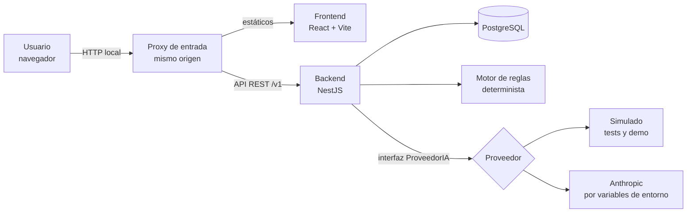
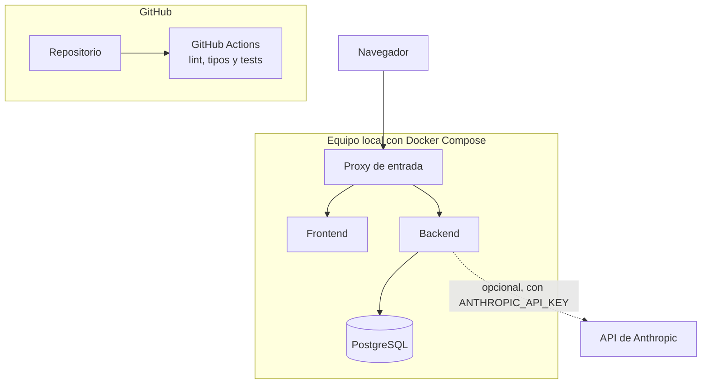
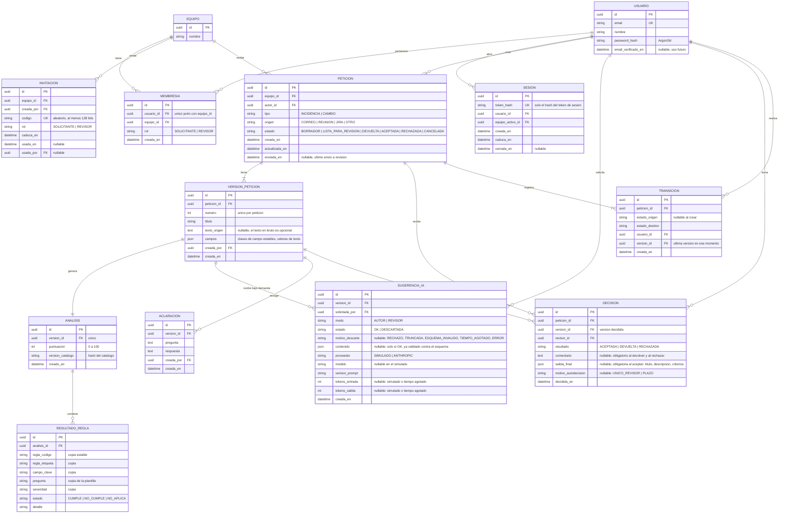

## Índice

0. [Ficha del proyecto](#0-ficha-del-proyecto)
1. [Descripción general del producto](#1-descripción-general-del-producto)
2. [Arquitectura del sistema](#2-arquitectura-del-sistema)
3. [Modelo de datos](#3-modelo-de-datos)
4. [Especificación de la API](#4-especificación-de-la-api)
5. [Historias de usuario](#5-historias-de-usuario)
6. [Tickets de trabajo](#6-tickets-de-trabajo)
7. [Pull requests](#7-pull-requests)

---

## 0. Ficha del proyecto

### **0.1. Tu nombre completo:**

Javier Sánchez

### **0.2. Nombre del proyecto:**

**Umbral**: *Unclear Messages Become Ready, Actionable and Listed* 

### **0.3. Descripción breve del proyecto:**

Herramienta web para que un equipo de desarrollo reciba peticiones completas. Comprueba con reglas deterministas qué le falta a cada petición, pregunta al solicitante hasta completarla y la pasa a un revisor, que la acepta y la exporta como texto listo para Jira. Una IA opcional ayuda con sugerencias, pero nunca decide si una petición está completa.

### **0.4. URL del proyecto:**

No hay despliegue público: el sistema se ejecutará en local con Docker Compose (ver 1.4). La evidencia de funcionamiento (capturas o vídeo) se aportará en la entrega final.

### 0.5. URL o archivo comprimido del repositorio

[github.com/jsgimenezia/AI4Devs-finalproject](https://github.com/jsgimenezia/AI4Devs-finalproject), repositorio público. Esta entrega está en la rama `feature/entrega-1-JSG`.

---

## 1. Descripción general del producto

> **Estado:** la Entrega 1 es solo documentación. Todo lo que describe este README está **previsto**, no implementado, salvo la medición de la IA, que sí se hizo. La especificación completa está en [`docs/producto.md`](docs/producto.md), que es la fuente de verdad del producto.

### **1.1. Objetivo:**

**El problema.** En los equipos que desarrollan software, las peticiones llegan por varias vías (el gestor de tareas, el correo, las reuniones), con formatos desiguales y con información que falta. El equipo pide aclaraciones una y otra vez, las estimaciones salen mal y el trabajo empieza con una idea difusa de lo que se quiere. Todo debería acabar en el gestor de tareas, pero muchas veces hay que reconstruir el contenido.

Dos ejemplos ficticios del tipo de petición que llega:

- *Un correo:* «Desde anteayer por la tarde baja cada día el número de solicitudes que se completan, mientras sube el de las que se inician. Me lo ha comentado el responsable del área.» No hay cifras, ni fechas absolutas, ni pantalla afectada, ni urgencia.
- *Un ticket:* título «Botón recuperar contraseña como secundario» y una descripción que pide que el secundario sea el botón de **iniciar sesión sin contraseña**. El título contradice a la descripción, no hay métrica de éxito y no hay diseño.

**Qué hace Umbral.** Automatiza lo que hoy se hace a mano: pedir siempre los mismos datos, de forma consistente y sin depender de la memoria de quien revisa. El solicitante pega el texto en bruto y elige el tipo de petición. La herramienta comprueba con reglas si están los datos que el equipo necesita, pregunta por cada uno que falte y no deja enviar la petición a revisión hasta que está completa. Un revisor la acepta, la devuelve o la rechaza, y la petición aceptada se exporta como historia de usuario o ticket de investigación.

**Para quién.** Para equipos que desarrollan un producto de software, de cualquier sector. Hay dos roles:

- **Solicitante:** quien pide el trabajo. Crea la petición, la completa y responde a las preguntas.
- **Revisor:** quien decide si la petición está lista para el equipo. También administra el equipo e invita a sus miembros.

**El valor.** No está en que una IA critique un texto, algo que ya se puede hacer con un chat, sino en tres cosas:

1. un **bucle de aclaración** entre solicitante y equipo, que hoy se hace por correo o en reuniones;
2. **reglas explícitas y comprobables**, que dan siempre el mismo resultado y están pensadas para adaptarse a cada equipo más adelante;
3. el **historial** de cómo mejora cada petición, versión a versión.

**La IA asiste, no decide.** Si una petición está completa lo deciden las reglas y, al final, una persona. La IA solo propone, y todo lo que propone es una sugerencia editable. Sin IA, la herramienta funciona igual, rellenando los campos a mano.

### **1.2. Características y funcionalidades principales:**

**Funcionalidades:**

1. **Cuentas y equipos.** Quien se registra crea un equipo y queda como revisor. Después invita a otras personas con un código de un solo uso que lleva asociado el rol. La sesión se guarda en el servidor y caduca a las 8 horas.
2. **Alta de una petición.** Título, tipo (*incidencia o anomalía*, o *cambio o mejora*), origen (correo, reunión, Jira u otro) y, si se tiene, el texto en bruto.
3. **Campos estructurados por tipo.** Cada tipo tiene sus campos: qué se observa, valores actual y de referencia, fecha de inicio, alcance, comportamiento actual y deseado, motivo, métrica de éxito, enlace a diseño… Los formularios se dibujan a partir de las definiciones de las reglas, no campo a campo. Se usan enlaces, no archivos adjuntos.
4. **Evaluación con reglas deterministas.** Doce reglas para incidencias y once para cambios, cada una sobre un campo y con una comprobación de un conjunto cerrado: texto obligatorio, contiene una cifra, fecha absoluta, enlace válido u opción de una lista. Da una **puntuación de completitud** visible y avisa de términos vagos («lo antes posible», «mejorar») cuando no van acompañados de una cifra.
5. **Preguntas y bucle de aclaración.** Por cada regla que no se cumple, una pregunta de plantilla. El solicitante responde rellenando el campo, y cada guardado crea una **versión nueva** que se vuelve a evaluar. El historial muestra cómo evoluciona la puntuación.
6. **Umbral de envío.** La petición solo puede enviarse a revisión cuando cumple todas las reglas obligatorias. La puntuación informa, pero lo que decide es esa condición.
7. **Revisión.** El revisor acepta, devuelve con un comentario (y la petición vuelve a ser editable) o rechaza con un comentario. Antes de aceptar puede editar la salida final. Un revisor no decide sobre sus propias peticiones, salvo que sea el único revisor del equipo o que lleven más de 7 días sin decisión.
8. **Salida y exportación.** Una plantilla determinista compone una **historia de usuario** (para los cambios) o un **ticket de investigación** (para las incidencias), que se exporta como texto listo para pegar en Jira.
9. **Asistencia con IA (opcional).** En **modo autor**, propone valores para los campos a partir del texto, preguntas adicionales, un título y un aviso si el título y el texto se contradicen. En **modo revisor**, propone criterios de aceptación o hipótesis. Todo se muestra como sugerencia y nunca se aplica solo. Sin clave, funciona con un **proveedor simulado**, marcado como «Simulado» en la interfaz. El proveedor real es Anthropic, con el modelo `claude-sonnet-5-5`, elegido midiendo varios modelos: ninguno inventó cifras ni fechas (detalle en `docs/producto.md`, 12.2).
10. **Aislamiento y permisos.** Cada equipo solo ve sus datos. Dentro del equipo, un solicitante solo ve sus peticiones, y un revisor ve además las del equipo que se han enviado a revisión.

**Historias del MVP.** El alcance se organiza en cinco historias imprescindibles y dos deseables:

| Id | Historia | Prioridad |
|---|---|---|
| H1 | Crear el equipo e invitar a otras personas con un rol | Imprescindible |
| H2 | Registrar una petición y ver qué le falta | Imprescindible |
| H3 | Completarla, ver cómo mejora y enviarla a revisión | Imprescindible |
| H4 | Revisar las peticiones enviadas y aceptarlas, devolverlas o rechazarlas | Imprescindible |
| H5 | Exportar una petición aceptada como texto listo para Jira | Imprescindible |
| S1 | Recibir de la IA propuestas de campos y preguntas | Deseable |
| S2 | Recibir de la IA criterios de aceptación o hipótesis | Deseable |

Las dos deseables son la IA. Como la herramienta funciona completa sin ella, pueden recortarse enteras si el plan se tuerce, sin tocar las imprescindibles. Las historias H2, H3 y H4 se detallan en la sección 5.

**Fuera del MVP:** integración directa con la API de Jira, archivos adjuntos, reglas personalizadas por equipo, notificaciones y panel de métricas.

### **1.3. Diseño y experiencia de usuario:**

> La interfaz se construye en la Entrega 2, así que aquí no hay capturas ni vídeo. Se describe el flujo de pantallas previsto. Las capturas y el vídeo del sistema funcionando llegarán en la entrega final.

**Pantallas previstas:**

1. **Acceso:** registro (nombre, email, contraseña y nombre del equipo), inicio de sesión y registro con un código de invitación.
2. **Listado de peticiones:** filtros por estado y tipo, con un indicador de «con carencias» o «completa».
3. **Nueva petición:** título, tipo, origen y texto en bruto (opcional).
4. **Detalle y edición:** formulario por campos, panel de reglas con su resultado y la puntuación, avisos de términos vagos, sugerencias de la IA (para aceptarlas o ignorarlas), decisiones con su comentario, y botones de guardar, enviar, retirar o cancelar.
5. **Historial de versiones:** evolución de la puntuación y de las reglas que fallaban.
6. **Revisión:** vista previa de la salida, petición de criterios a la IA, edición de la salida final y decisión con comentario.
7. **Exportación:** texto listo para copiar.
8. **Invitaciones** (revisor): generar códigos y ver su estado.

**Recorrido típico**, con el ticket del ejemplo de 1.1:

1. El solicitante pega el ticket, elige el tipo *cambio* y pide ayuda a la IA. La IA propone los campos que encuentra en el texto y avisa de que el título contradice a la descripción. El solicitante acepta parte de la propuesta, incluido un título corregido.
2. Las reglas muestran lo que falta: métrica de éxito, alcance y enlace al diseño. La puntuación es 67 y la petición no se puede enviar.
3. El solicitante responde a las tres preguntas («+15% de recuperaciones de contraseña en 30 días», «Pantalla de login, web y móvil» y el enlace al diseño). La puntuación sube a 100 y la envía a revisión.
4. Un revisor abre la vista previa, pide a la IA criterios de aceptación y corrige uno que tomaba una decisión de producto que nadie había pedido. Después acepta.
5. La petición aceptada se exporta como historia de usuario lista para pegar en Jira.

**Principios de la experiencia:**

- Lo que propone la IA siempre se ve como sugerencia, nunca como un dato.
- Cada pregunta dice qué falta y por qué.
- La puntuación es visible, pero lo que permite enviar es cumplir las reglas obligatorias.

### **1.4. Instrucciones de instalación:**

> **Previsto, no verificado:** todavía no hay código. Estas instrucciones describen cómo se pondrá en marcha el proyecto y se completarán en la Entrega 2. La guía definitiva se comprobará en un directorio limpio antes de la entrega final.

**Requisitos:** Git, y Docker con Docker Compose. Node.js solo hará falta para desarrollar sin contenedores; las versiones concretas se fijarán al crear el código.

**Puesta en marcha prevista:**

1. Clonar el repositorio:

   ```bash
   git clone https://github.com/jsgimenezia/AI4Devs-finalproject.git
   cd AI4Devs-finalproject
   ```

2. Copiar el archivo de ejemplo de variables de entorno, que estará versionado, y ajustarlo si hace falta. **No hace falta ninguna clave de IA**: sin ella, la aplicación usa el proveedor simulado.
3. Levantar todo con `docker compose up`. Arranca la base de datos (PostgreSQL), el backend (NestJS), el frontend (React) y el proxy de entrada, que da un único punto de acceso desde el navegador.
4. Abrir en el navegador la dirección del proxy de entrada.

**Pendiente de definir en la Entrega 2:**

- el puerto de acceso;
- cómo se aplican las migraciones de la base de datos;
- los comandos para ejecutar los tests.

**Opciones:**

- **IA real:** definir `ANTHROPIC_API_KEY` en el entorno. La clave nunca se guarda en el repositorio.
- **Datos de demostración:** una variable de entorno activará la carga de un equipo ficticio, con dos revisores, un solicitante y tres peticiones en estados distintos. Las credenciales de prueba y los flujos que hay que verificar estarán en este README desde la Entrega 2.

---

## 2. Arquitectura del Sistema

### **2.1. Diagrama de arquitectura:**



**Patrón.** Es un **monolito modular por capas**: un único backend organizado en módulos por dominio (cuentas, equipos, peticiones, reglas, análisis, revisión, exportación e IA), cada uno con las capas controlador, servicio y acceso a datos. Hay dos puntos que dependen de interfaces y no de implementaciones concretas, al estilo de los puertos y adaptadores:
- **la fuente de las reglas:** hoy es configuración, y mañana podrá ser una tabla por equipo;
- **el proveedor de IA:** simulado o real.

El frontend es una aplicación de una sola página que habla con la API REST versionada (`/v1`). Todo vive en un repositorio único con tres paquetes: backend, frontend y uno compartido.

**Por qué esta arquitectura:**
- **Tamaño y plazo.** Un MVP individual de unas 30 horas no necesita microservicios. Un monolito se arranca con un comando, se prueba entero y se entiende de un vistazo.
- **Un solo lenguaje.** TypeScript en todo el proyecto. El paquete compartido define una sola vez los esquemas de los campos y de la salida de la IA, y los usan el backend y el frontend.
- **El núcleo es determinista y fácil de probar.** El motor de reglas es una función pura: recibe los campos, las definiciones y la fecha de referencia, y no depende de la red, del reloj ni de la IA. Se prueba con tests unitarios exhaustivos y da siempre el mismo resultado.
- **Desarrollo con IA.** Módulos con límites claros, tipos estrictos y especificación precisa reducen lo que un agente de código tiene que inventar.

**Beneficios:**
- La IA se puede quitar o cambiar sin tocar el dominio.
- Las reglas podrán pasar a base de datos sin cambiar el motor.
- El aislamiento entre equipos se impone en un único sitio: la capa de acceso a datos.
- Los formularios se dibujan desde las definiciones de las reglas, así que no pueden desalinearse.

**Sacrificios y déficits:**
- **Una sola instancia del backend.** Los contadores del límite de intentos de inicio de sesión viven en memoria: no sirven con varias instancias y se reinician al reiniciar el servidor.
- **Cambiar una regla exige desplegar.** En el MVP no hay pantalla para editar reglas, porque viven en configuración.
- **Riesgo de XSS aceptado.** El token de sesión se guarda en el navegador (`localStorage`) en lugar de en una cookie `HttpOnly` (ver 2.5).
- **Sin escalado ni alta disponibilidad.** El sistema solo se ejecuta en local.
- **La evaluación es síncrona.** Se calcula al guardar cada versión. Vale para el volumen de un equipo, no para cargas grandes.

### **2.2. Descripción de componentes principales:**

| Componente | Tecnología | Responsabilidad |
|---|---|---|
| Proxy de entrada | Servidor web ligero en un contenedor | Da un único punto de entrada: sirve el frontend y reenvía `/v1` al backend, así que navegador, frontend y API comparten origen y no hace falta CORS. Escribe la dirección del cliente en `X-Forwarded-For`, de la que depende el límite de intentos |
| Frontend | React + Vite, TypeScript | Pantallas de 1.3; formulario dibujado desde las definiciones de reglas, con un componente por tipo de comprobación |
| Backend | NestJS, TypeScript | API REST, autenticación y sesiones, permisos por rol, aislamiento por equipo y flujo de estados con transiciones atómicas |
| Motor de reglas | TypeScript, dentro del backend | Evalúa los campos de cada versión con el catálogo de reglas, leído a través de una interfaz |
| Compositor de salida | TypeScript, dentro del backend | Compone la historia de usuario o el ticket de investigación con plantillas deterministas |
| Paquete compartido | TypeScript + Zod | Esquemas de los campos y de la salida de la IA, y tipos comunes. El backend es el que manda; el frontend repite la validación solo para la experiencia de usuario |
| Servicio de IA | TypeScript, dentro del backend | Prepara la llamada según el modo (autor o revisor), valida la respuesta contra su esquema y aplica los límites de uso, la espera máxima y los reintentos |
| Proveedor de IA | Interfaz con dos implementaciones | **Simulado:** determinista, por defecto, para tests y demostración. **Real:** Anthropic con su SDK oficial de TypeScript y salida estructurada; modelo `claude-sonnet-5-5` con esfuerzo `low`, elegido midiendo (ver 2.6) |
| Base de datos | PostgreSQL + Prisma | Persistencia, migraciones versionadas y disparadores de solo añadir (sección 3) |

**Stack tecnológico:**

| Capa | Tecnología | Motivo |
|---|---|---|
| Lenguaje | TypeScript en todo el proyecto | Un solo lenguaje; los tipos detectan errores del código generado por IA |
| Frontend | React + Vite | Estándar de mercado, con mucho código de referencia |
| Backend | NestJS (Node.js) | Estructura modular y capas claras |
| Base de datos | PostgreSQL | Relacional, con integridad referencial y soporte de JSON |
| ORM y migraciones | Prisma | Esquema declarativo y migraciones versionadas |
| Validación | Zod, en el paquete compartido | Un único esquema para campos y salida de la IA |
| Tests | Vitest o Jest (unitarios), Supertest (integración), Playwright (E2E) | Cubren los tres niveles con TypeScript |
| Contenedores | Docker Compose | El mismo arranque en cualquier máquina |
| Integración continua | GitHub Actions | Ejecuta los tests en cada cambio |
| IA | SDK oficial de Anthropic para TypeScript | Salida estructurada con esquema |
| Desarrollo con IA | Claude Code, con `CLAUDE.md` y hooks | Práctica del máster; los prompts se registran en `prompts.md` |

Las versiones concretas se fijarán al crear el código.

### **2.3. Descripción de alto nivel del proyecto y estructura de ficheros**

Repositorio único con tres paquetes. Estructura prevista; los nombres de las carpetas son orientativos y se fijarán al crear el código en la Entrega 2:

```text
/
├── backend/              API en NestJS
│   ├── src/
│   │   ├── cuentas/      registro, sesión, invitaciones
│   │   ├── equipos/      equipos y membresías
│   │   ├── peticiones/   peticiones, versiones, estados y transiciones
│   │   ├── reglas/       catálogo como configuración e interfaz de lectura
│   │   ├── analisis/     motor de reglas y puntuación
│   │   ├── revision/     decisiones y salida final
│   │   ├── exportacion/  compositor de salida y texto para Jira
│   │   └── ia/           servicio de IA y proveedores simulado y real
│   ├── prisma/           esquema, migraciones y datos de demostración
│   └── test/             tests de integración
├── frontend/             aplicación React + Vite
├── compartido/           esquemas Zod y tipos comunes
├── e2e/                  tests de Playwright
├── proxy/                configuración del proxy de entrada
├── docs/producto.md      documento de producto: la fuente de verdad
├── docker-compose.yml
├── .github/workflows/    integración continua
├── CLAUDE.md             reglas de trabajo para el agente de código
├── readme.md
└── prompts.md
```

**Organización:**
- **El backend sigue la estructura modular de NestJS**, un módulo por dominio, cada uno con sus capas.
- **Las dependencias van en un solo sentido:** el dominio no conoce ni la fuente de las reglas ni el proveedor de IA, porque los recibe a través de interfaces.
- **El script de medición de la IA** (`scripts/spike/`) vive en la rama `spike/medicion-ia` y se incorporará con la Entrega 2.

### **2.4. Infraestructura y despliegue**



**Infraestructura:**
- **Contenedores:** `docker compose up` levantará cuatro, el proxy de entrada, el frontend, el backend y PostgreSQL. No hace falta ninguna clave de IA.
- **IA real:** es la única dependencia externa, y es opcional. Se activa definiendo `ANTHROPIC_API_KEY` en el entorno.
- **Configuración:** se describe en un archivo de ejemplo de variables de entorno, versionado y sin secretos.

**Despliegue:**
- **Sin URL pública.** La entrega final se ejecuta en local, con la guía de 1.4 comprobada en un directorio limpio.
- **Evidencia:** capturas o vídeo del sistema funcionando, indicando si las respuestas de la IA proceden del proveedor simulado o del real.
- **Servidor:** en la entrega final se documentará cómo se llevaría a un servidor, sin ejecutarlo.

**Integración continua:** un flujo de GitHub Actions en cada *push* y cada pull request:
1. instala las dependencias;
2. pasa el lint y la comprobación de tipos;
3. ejecuta los tests unitarios y el conjunto de evaluación con el proveedor simulado;
4. ejecuta los tests de integración con un servicio PostgreSQL;
5. ejecuta los tests E2E, si el tiempo de ejecución lo permite;
6. mide la cobertura de verdad, sin umbrales prometidos.

No despliega ni llama al proveedor real.

### **2.5. Seguridad**

Prácticas previstas:

- **Contraseñas:** se guardan con hash Argon2id, con un mínimo de 10 caracteres.
- **Sesión en el servidor:**
  - al iniciar sesión se crea un token aleatorio, y en la base de datos solo se guarda su hash;
  - el frontend lo guarda en `localStorage` y lo envía en la cabecera `Authorization` en cada petición;
  - la sesión caduca a las 8 horas sin renovarse con la actividad, y cerrar sesión la invalida en el servidor.
- **Riesgo aceptado: XSS.** Un script malicioso que llegara a ejecutarse en la página podría leer el token, cosa que una cookie `HttpOnly` impediría.
  - **Por qué se acepta:** el sistema solo se ejecuta en local y la planificación va justa. La cookie con protección CSRF añadía trabajo y pruebas sin mejorar las garantías de la sesión en el servidor.
  - **Lo que lo reduce:** React escapa el contenido, el frontend no inserta HTML sin escapar, el texto de las peticiones y la salida de la IA se tratan como datos, y solo se muestran como enlace las URL http o https.
  - **Mejora anotada:** una política de seguridad de contenido (CSP) en el proxy.
- **Límite de intentos:** 5 intentos fallidos en 15 minutos bloquean temporalmente (429) el inicio de sesión (por email y dirección), el registro y los códigos de invitación (por dirección). La dirección del cliente se toma de `X-Forwarded-For` solo cuando la petición llega del proxy de entrada. Sin eso, todos los usuarios compartirían la dirección del proxy y unos pocos fallos bloquearían a todo el mundo.
- **Mensajes genéricos:** un email ya registrado, unas credenciales incorrectas o un código de invitación no válido reciben un mensaje que no distingue la causa. Sin verificación por email no se puede evitar del todo que se deduzca si una cuenta existe; es un riesgo aceptado, frenado por el límite de intentos.
- **Aislamiento entre equipos:**
  - las consultas pasan por repositorios que exigen el equipo de la sesión;
  - un recurso que el usuario no puede ver responde siempre 404, sea de otro equipo o del propio, para no revelar que existe;
  - un test recorre todos los endpoints y falla si aparece una ruta que no esté incluida en él.
- **Permisos por rol:** la matriz de permisos se aplica en el backend. Por ejemplo, un revisor no decide sobre sus propias peticiones salvo en los casos de autodecisión. Las acciones no permitidas responden 403 por el rol y 409 por el estado.
- **Códigos de invitación:** aleatorios de al menos 128 bits, de un solo uso, con caducidad de 7 días y marcado atómico.
- **IA y entrada no confiable:**
  - el texto de las peticiones va delimitado como dato no confiable, con instrucciones al modelo de no seguir lo que contenga;
  - la salida se valida contra un esquema cerrado y nunca se ejecuta;
  - hay límites de uso por usuario, por equipo y global (429), y un tope de gasto en la cuenta del proveedor.
- **Secretos:** la clave de la IA nunca entra en el repositorio; se lee de una variable de entorno.
- **Datos:** el repositorio y los tests solo usan datos ficticios. Los datos de demostración, con credenciales de prueba, solo se cargan si lo activa una variable de entorno.

### **2.6. Tests**

> Los tests de la aplicación están **previstos**: se escribirán con el código, a partir de la Entrega 2. La **medición de la IA**, en cambio, **ya se ha hecho** y sus resultados están al final de este apartado.

**Niveles de prueba previstos:**
- **Unitarios (Vitest o Jest):**
  - cada tipo de comprobación, con casos que cumplen y que no cumplen, y cada regla del catálogo;
  - puntuación y condición de «completa», transiciones permitidas y prohibidas, y matriz de permisos;
  - autodecisión, con un reloj inyectable para el plazo de 7 días;
  - plantillas de salida y validación de los esquemas de la IA.
- **Integración (Supertest contra PostgreSQL real):**
  - registro e invitaciones, incluido un código usado en dos registros simultáneos;
  - sesión: inicio, cierre, caducidad a las 8 horas y token en la cabecera `Authorization`;
  - conflictos de versión y de estado (409), y transiciones concurrentes;
  - disparadores de solo añadir;
  - aislamiento entre equipos en todos los endpoints;
  - límites de la IA (429) y fallo de la IA sin bloquear el flujo;
  - datos de demostración que no se cargan sin su variable.
- **E2E (Playwright), dos recorridos:**
  - **(a) Equipo con un solo revisor:** registrarse, pegar una petición, completarla, enviarla, aceptarla como único revisor y exportarla.
  - **(b) Equipo con dos revisores:** devolución con comentario, corrección, reenvío, aceptación y exportación.

**Conjunto de evaluación:** de 10 a 15 peticiones ficticias con los valores esperados de cada campo. En la integración continua se ejecuta con el proveedor simulado, que prueba la tubería pero no la calidad de ningún modelo.

**Trazabilidad:** cada requisito y cada regla se enlazará con al menos un test y con el comando que lo ejecuta.

**Medición de la IA (hecha el 18 de noviembre de 2026):**
- **Qué se midió:** el modo autor, con 6 peticiones ficticias, 3 ejecuciones por caso y 18 llamadas por configuración.
- **Criterio, fijado antes de medir:**
  - cero cifras o fechas inventadas;
  - al menos un 70 % de aciertos en los campos;
  - ninguna llamada por encima de 60 s;
  - coste medio de 0,05 USD por llamada como máximo.
- **Dónde está:** el script y los resultados, en la rama `spike/medicion-ia`.

| Configuración | Aciertos | Cifras o fechas inventadas | Tiempo máximo | Coste por llamada | Detecta la contradicción del ejemplo |
|---|---|---|---|---|---|
| Opus 5.5, esfuerzo bajo | 91,8 % | 0 | 33,5 s | 0,019 USD | 3 de 3 |
| **Sonnet 5.5, esfuerzo bajo** | **87,9 %** | **0** | **3,6 s** | **0,008 USD** | **3 de 3** |
| Sonnet 5.5, esfuerzo medio | 87,4 % | 0 | 3,8 s | 0,009 USD | 3 de 3 |
| Haiku 5.5, esfuerzo bajo | 88,9 % | 0 | 3,0 s | 0,0005 USD | 0 de 3 |
| Haiku 5.5, esfuerzo medio | 88,9 % | 0 | 6,4 s | 0,0007 USD | 2 de 3 |

**Resultado:**
- **La IA compensa:** las cinco configuraciones cumplen el criterio.
- **Decisión: Sonnet 5.5 con esfuerzo bajo, como desviación documentada.** El criterio elegía la más barata, Haiku con esfuerzo bajo. Pero el criterio solo puntuaba los campos, y la revisión manual mostró que Haiku no detecta la contradicción entre título y texto del ejemplo y repite preguntas que ya hacen las reglas.
- **Limitación:** con 6 casos, la medición sirve para decidir en este MVP, no como garantía de calidad.

---

## 3. Modelo de Datos

### **3.1. Diagrama del modelo de datos:**

> Modelo previsto para PostgreSQL (con Prisma). Los nombres de entidades y atributos pueden ajustarse en el diseño detallado de la Entrega 2.



### **3.2. Descripción de entidades principales:**

**Convenciones:**
- Todas las claves primarias son `uuid`.
- Un atributo es obligatorio (`NOT NULL`) salvo que se indique «nulo».
- `PK` es clave primaria, `FK` clave foránea y `UK` valor único.
- Los atributos con valores en mayúsculas (`rol`, `estado`…) solo admiten los valores indicados.

**Ideas que ordenan el modelo:**

- **La petición está separada de su contenido.** `PETICION` guarda la identidad y el estado. Cada guardado crea una `VERSION_PETICION` nueva con el contenido de ese momento, y cada versión tiene un único `ANALISIS` con el resultado de cada regla. Así hay historial, comparación entre versiones y trazabilidad.
- **Tablas de solo añadir.** `VERSION_PETICION`, `ANALISIS`, `RESULTADO_REGLA`, `SUGERENCIA_IA`, `ACLARACION`, `DECISION` y `TRANSICION` nunca se modifican ni se borran. En `PETICION` solo cambian `estado`, `actualizada_en` y `enviada_en`. Unos disparadores de PostgreSQL rechazarán `UPDATE` y `DELETE` en esas tablas. Si hay que recortar, son lo primero que se quita, y entonces la garantía queda en la capa de acceso a datos.
- **Aislamiento entre equipos.** Todos los datos de negocio cuelgan de un equipo, directamente (`equipo_id`) o a través de la petición. Todas las consultas parten del equipo activo de la sesión.
- **Las reglas no son tablas.** El catálogo de reglas (12 para incidencias y 11 para cambios) y el vocabulario de términos vagos viven como configuración tipada del backend, leída a través de una interfaz. Por eso `RESULTADO_REGLA` guarda una **copia** de la regla y no tiene clave foránea hacia ella: el historial no cambia aunque la regla cambie después.

**Entidades:**

| Entidad | Para qué sirve | Atributos y restricciones principales | Relaciones |
|---|---|---|---|
| `EQUIPO` | Unidad de aislamiento de datos | `nombre` | Tiene membresías, invitaciones y peticiones (1:N) |
| `USUARIO` | Persona registrada | `email` (`UK`); `nombre`; `password_hash` (Argon2id, nunca la contraseña); `email_verificado_en` (nulo, reservado para el futuro) | Pertenece a equipos mediante `MEMBRESIA`; abre sesiones; crea peticiones; solicita sugerencias; toma decisiones; realiza transiciones |
| `MEMBRESIA` | Relación N:M entre usuario y equipo, con rol | `usuario_id` (`FK`); `equipo_id` (`FK`); `rol` (`SOLICITANTE` o `REVISOR`); `creada_en`. La pareja (`usuario_id`, `equipo_id`) es única | N:1 con `USUARIO` y con `EQUIPO`. El esquema admite varias por usuario; el MVP aplica una por usuario |
| `SESION` | Sesión en el servidor | `token_hash` (`UK`; solo el hash, nunca el token); `usuario_id` (`FK`); `equipo_activo_id` (`FK` a `EQUIPO`); `creada_en`; `caduca_en` (8 horas tras el inicio, sin renovación); `cerrada_en` (nulo hasta cerrar sesión) | N:1 con `USUARIO`. El equipo activo es la membresía más antigua |
| `INVITACION` | Código para unirse a un equipo con un rol | `equipo_id` (`FK`); `creada_por` (`FK` a `USUARIO`); `codigo` (`UK`; aleatorio de al menos 128 bits); `rol`; `caduca_en`; `usada_en` y `usada_por` (nulos hasta usarse) | N:1 con `EQUIPO`. Se marca como usada en la misma transacción que crea el usuario y la membresía, con una actualización condicionada a que siga sin usar y sin caducar, para que no pueda usarse dos veces |
| `PETICION` | Identidad y estado de una petición | `equipo_id` (`FK`); `autor_id` (`FK` a `USUARIO`); `tipo` (`INCIDENCIA` o `CAMBIO`; no cambia tras crearla); `origen` (`CORREO`, `REUNION`, `JIRA` u `OTRO`); `estado` (los seis estados del flujo); `creada_en`; `actualizada_en`; `enviada_en` (nulo; último envío a revisión) | N:1 con `EQUIPO` y con su autor; 1:N con versiones (al menos una), decisiones y transiciones |
| `VERSION_PETICION` | Contenido de la petición en un momento dado | `peticion_id` (`FK`); `numero` (único por petición); `titulo` (hasta 120 caracteres); `texto_origen` (nulo; texto en bruto, hasta 10.000 caracteres); `campos` (JSON con las claves de campo del tipo y valores de texto); `creada_por` (`FK`); `creada_en` | N:1 con `PETICION`; 1:1 con `ANALISIS`; 1:N con sugerencias, aclaraciones y decisiones. Al guardar se indica el número sobre el que se trabaja: si ya existe uno posterior, se rechaza con un conflicto (409) |
| `ANALISIS` | Resultado de evaluar una versión con las reglas | `version_id` (`FK`, `UK`); `puntuacion` (entero de 0 a 100); `version_catalogo` (hash del catálogo de reglas usado); `creado_en` | 1:1 con `VERSION_PETICION`; 1:N con `RESULTADO_REGLA` |
| `RESULTADO_REGLA` | Resultado de una regla en un análisis | `analisis_id` (`FK`); copia de `regla_codigo`, `regla_etiqueta`, `campo_clave`, `pregunta` y `severidad`; `estado` (`CUMPLE`, `NO_CUMPLE` o `NO_APLICA`); `detalle` (explicación del resultado; formato y obligatoriedad por fijar) | N:1 con `ANALISIS`. Sin clave foránea a ninguna regla. La pregunta de plantilla que ve el solicitante es la de los resultados `NO_CUMPLE` |
| `SUGERENCIA_IA` | Cada llamada al proveedor de IA | `version_id` (`FK`); `solicitada_por` (`FK` a `USUARIO`); `modo` (`AUTOR` o `REVISOR`); `estado` (`OK` o `DESCARTADA`); `motivo_descarte` (nulo; rechazo, truncada, esquema inválido, tiempo agotado o error); `contenido` (JSON, nulo; solo si es `OK` y ya validado contra el esquema); `proveedor` (`SIMULADO` o `ANTHROPIC`); `modelo` (nulo en el simulado); `version_prompt`; `tokens_entrada` y `tokens_salida` (nulos en el simulado o si se agotó el tiempo); `creada_en` | N:1 con `VERSION_PETICION` y con el usuario que la pidió. Se guardan también las descartadas, porque sirven para medir el coste y aplicar los límites de uso |
| `ACLARACION` | Respuesta del solicitante a una pregunta adicional de la IA | `version_id` (`FK`); `pregunta`; `respuesta`; `creada_por` (`FK`); `creada_en` | N:1 con `VERSION_PETICION` (la última en el momento de responder). No crea una versión nueva |
| `DECISION` | Decisión del revisor | `peticion_id` (`FK`); `version_id` (`FK`; versión decidida); `revisor_id` (`FK` a `USUARIO`); `resultado` (`ACEPTADA`, `DEVUELTA` o `RECHAZADA`); `comentario` (nulo; obligatorio al devolver y al rechazar); `salida_final` (JSON, nulo; obligatorio al aceptar, con título, descripción y criterios, y es lo que se exporta); `motivo_autodecision` (nulo; `UNICO_REVISOR` o `PLAZO` cuando el revisor decide sobre su propia petición); `decidida_en` | N:1 con `PETICION`, con la versión decidida y con el revisor |
| `TRANSICION` | Registro de cada cambio de estado | `peticion_id` (`FK`); `estado_origen` (nulo al crear la petición); `estado_destino`; `usuario_id` (`FK`); `version_id` (`FK`; última versión en ese momento); `creada_en` | N:1 con `PETICION`, con el usuario y con la versión. Cada transición se aplica solo si la petición sigue en el estado de origen; si no, se rechaza con un conflicto y no se registra nada |

**Lo que no es una tabla en el MVP:** las definiciones de reglas y los términos vagos (configuración tipada) y las preguntas de plantilla, que son el campo `pregunta` de los resultados que no se cumplen.

---

## 4. Especificación de la API

La API es REST, va bajo `/v1` y usa JSON. Estos son los tres endpoints que sostienen el flujo principal: crear una petición, completarla versión a versión y decidir sobre ella. Todos exigen el token de sesión en la cabecera `Authorization`. El resto de rutas está en [`docs/producto.md`](docs/producto.md), sección 10.4.

> Especificación prevista, no implementada. La forma exacta de las respuestas puede ajustarse en la Entrega 2; lo que no cambia son las reglas de negocio y los códigos de error.

**Códigos de error comunes:**

| Código | Cuándo |
|---|---|
| 400 | Entrada inválida: falta un dato, sobra una clave de campo, una opción no está en la lista o un texto supera su longitud |
| 401 | Sin cabecera `Authorization`, o con un token no válido, cerrado o caducado |
| 403 | El usuario puede ver la petición, pero su rol o su relación con ella no le permiten la acción |
| 404 | La petición no existe o el usuario no puede verla: es de otro equipo o es un borrador ajeno. Nunca se distingue entre los dos casos |
| 409 | Conflicto: la versión indicada ya no es la última, la petición no está en un estado que permita la acción o ha cambiado entre la lectura y la escritura |
| 422 | La petición no cumple las reglas obligatorias para enviarse a revisión |

Se comprueba en este orden: primero si el usuario puede ver la petición (404), luego si su rol se lo permite (403) y por último si el estado lo permite (409).

```yaml
openapi: 3.0.3
info:
  title: Umbral API
  version: 0.1.0
  description: Endpoints principales del flujo de una petición (especificación prevista).
servers:
  - url: /v1
security:
  - sesion: []

paths:
  /peticiones:
    post:
      summary: Crear una petición
      description: >
        Crea la petición en estado BORRADOR, con su primera versión (sin campos)
        y el análisis de esa versión. Puede hacerlo cualquier miembro del equipo activo.
      operationId: crearPeticion
      requestBody:
        required: true
        content:
          application/json:
            schema: { $ref: '#/components/schemas/CrearPeticion' }
            example:
              titulo: Botón recuperar contraseña como secundario
              tipo: CAMBIO
              origen: JIRA
              texto_origen: >-
                El botón de iniciar sesión sin contraseña debería ser secundario.
                Hoy hay dos botones al iniciar sesión y queremos que más usuarios
                recuperen su contraseña si no la recuerdan…
      responses:
        '201':
          description: Petición creada con su primera versión y su análisis.
          content:
            application/json:
              schema: { $ref: '#/components/schemas/Peticion' }
              example:
                id: 7f0c2b9e-4d1a-4c55-9a3e-2b8f6c1d0e47
                tipo: CAMBIO
                origen: JIRA
                estado: BORRADOR
                creada_en: '2026-11-21T10:00:00+01:00'
                enviada_en: null
                ultima_version:
                  numero: 1
                  titulo: Botón recuperar contraseña como secundario
                  texto_origen: El botón de iniciar sesión sin contraseña debería ser secundario…
                  campos: {}
                  analisis:
                    puntuacion: 0
                    completa: false
                    version_catalogo: 3b5d…
                    resultados:          # se muestran 2 de los 11
                      - regla_codigo: RC-01
                        regla_etiqueta: Comportamiento actual descrito
                        campo_clave: comportamiento_actual
                        severidad: OBLIGATORIA
                        estado: NO_CUMPLE
                        pregunta: ¿Cómo funciona hoy?   # texto de ejemplo
                      - regla_codigo: RC-06
                        regla_etiqueta: Métrica de éxito con su cifra
                        campo_clave: metrica_exito
                        severidad: OBLIGATORIA
                        estado: NO_APLICA
                        pregunta: null
                    avisos_terminos_vagos: []
        '400': { $ref: '#/components/responses/EntradaInvalida' }
        '401': { $ref: '#/components/responses/NoAutenticado' }

  /peticiones/{id}/versiones:
    post:
      summary: Guardar una versión nueva
      description: >
        Guarda los campos como una versión nueva y la evalúa con las reglas del tipo.
        Solo el autor, con la petición en BORRADOR o DEVUELTA. numero_base es la versión
        sobre la que se ha trabajado: si ya existe una posterior, responde 409 y no crea nada.
        La versión, el análisis y los resultados se crean en una sola transacción.
      operationId: guardarVersion
      parameters:
        - $ref: '#/components/parameters/IdPeticion'
      requestBody:
        required: true
        content:
          application/json:
            schema: { $ref: '#/components/schemas/GuardarVersion' }
            example:
              numero_base: 1
              titulo: Hacer secundario el botón de iniciar sesión sin contraseña
              texto_origen: El botón de iniciar sesión sin contraseña debería ser secundario…
              campos:
                comportamiento_actual: Hay dos botones en el inicio de sesión
                comportamiento_deseado: El botón de iniciar sesión sin contraseña debe ser secundario
                actor: Usuarios que no recuerdan su contraseña
                motivo: Que más usuarios recuperen la contraseña y queden con sesión iniciada
                tiene_metrica: SI
                afecta_interfaz: SI
      responses:
        '201':
          description: Versión creada y evaluada.
          content:
            application/json:
              schema: { $ref: '#/components/schemas/Version' }
              example:
                numero: 2
                titulo: Hacer secundario el botón de iniciar sesión sin contraseña
                campos: { tiene_metrica: SI, afecta_interfaz: SI }   # abreviado
                analisis:
                  puntuacion: 67        # 6 de 9 reglas obligatorias aplicables
                  completa: false
                  version_catalogo: 3b5d…
                  resultados:            # se muestra 1 de los 11
                    - regla_codigo: RC-06
                      regla_etiqueta: Métrica de éxito con su cifra
                      campo_clave: metrica_exito
                      severidad: OBLIGATORIA
                      estado: NO_CUMPLE
                      pregunta: ¿Con qué cifra se medirá el éxito?   # texto de ejemplo
                  avisos_terminos_vagos: []
        '400': { $ref: '#/components/responses/EntradaInvalida' }
        '401': { $ref: '#/components/responses/NoAutenticado' }
        '403': { $ref: '#/components/responses/AccionNoPermitida' }
        '404': { $ref: '#/components/responses/NoEncontrada' }
        '409': { $ref: '#/components/responses/Conflicto' }

  /peticiones/{id}/decision:
    post:
      summary: Decidir sobre una petición en revisión
      description: >
        Acepta, devuelve o rechaza una petición en LISTA_PARA_REVISION. El revisor indica
        la versión que ha visto y el enviada_en del envío que ha visto: si la versión ya
        no es la última, o si la petición se ha retirado y reenviado desde entonces,
        responde 409 y no registra nada. Un revisor no decide sobre sus propias peticiones,
        salvo que sea el único del equipo o que lleven más de 7 días sin decisión; en ese
        caso la decisión guarda motivo_autodecision.
      operationId: decidir
      parameters:
        - $ref: '#/components/parameters/IdPeticion'
      requestBody:
        required: true
        content:
          application/json:
            schema: { $ref: '#/components/schemas/Decidir' }
            examples:
              aceptar:
                value:
                  resultado: ACEPTADA
                  numero_version: 3
                  enviada_en: '2026-11-21T10:30:00+01:00'
                  salida_final:
                    titulo: Hacer secundario el botón de iniciar sesión sin contraseña
                    descripcion: >-
                      Como usuarios que no recuerdan su contraseña, queremos que el botón
                      de iniciar sesión sin contraseña sea secundario…
                    criterios:
                      - El botón de iniciar sesión sin contraseña se muestra con estilo secundario en web y móvil.
                      - El botón de iniciar sesión sin contraseña deja de mostrarse con estilo primario; el resto de la pantalla no cambia.
              devolver:
                value:
                  resultado: DEVUELTA
                  numero_version: 3
                  enviada_en: '2026-11-21T10:30:00+01:00'
                  comentario: Falta indicar si el cambio aplica también a la app móvil.
      responses:
        '201':
          description: Decisión registrada; la petición pasa al estado correspondiente.
          content:
            application/json:
              schema: { $ref: '#/components/schemas/Decision' }
              example:
                id: 2c9e5a10-8b7f-4e3d-b1a2-6f0d9c4e8a21
                resultado: ACEPTADA
                numero_version: 3
                estado_peticion: ACEPTADA
                motivo_autodecision: null
                decidida_en: '2026-11-21T11:05:00+01:00'
        '400': { $ref: '#/components/responses/EntradaInvalida' }
        '401': { $ref: '#/components/responses/NoAutenticado' }
        '403': { $ref: '#/components/responses/AccionNoPermitida' }
        '404': { $ref: '#/components/responses/NoEncontrada' }
        '409': { $ref: '#/components/responses/Conflicto' }

components:
  securitySchemes:
    sesion:
      type: http
      scheme: bearer
      description: Token de sesión devuelto por POST /auth/login. En el servidor solo se guarda su hash.

  parameters:
    IdPeticion:
      name: id
      in: path
      required: true
      schema: { type: string, format: uuid }

  responses:
    EntradaInvalida:
      description: Entrada inválida. Indica qué campo falla cuando se puede.
      content:
        application/json:
          schema: { $ref: '#/components/schemas/Error' }
          examples:
            titulo:
              value:
                codigo: ENTRADA_INVALIDA
                mensaje: Revisa los datos marcados.
                campos: { titulo: Es obligatorio y admite hasta 120 caracteres. }
            campo_desconocido:
              value:
                codigo: ENTRADA_INVALIDA
                mensaje: Revisa los datos marcados.
                campos: { color_boton: No es un campo de este tipo de petición. }
            sin_comentario:
              value:
                codigo: ENTRADA_INVALIDA
                mensaje: Revisa los datos marcados.
                campos: { comentario: Es obligatorio al devolver o rechazar. }
    NoAutenticado:
      description: Sin token de sesión, o con un token no válido, cerrado o caducado.
      content:
        application/json:
          schema: { $ref: '#/components/schemas/Error' }
          example:
            codigo: NO_AUTENTICADO
            mensaje: La sesión no es válida o ha caducado. Vuelve a iniciar sesión.
    AccionNoPermitida:
      description: El usuario puede ver la petición, pero su rol o su relación con ella no le permiten la acción.
      content:
        application/json:
          schema: { $ref: '#/components/schemas/Error' }
          examples:
            editar_ajena:
              value:
                codigo: ACCION_NO_PERMITIDA
                mensaje: Solo el autor puede editar esta petición.
            decidir_propia:
              value:
                codigo: ACCION_NO_PERMITIDA
                mensaje: No puedes decidir sobre tu propia petición.
    NoEncontrada:
      description: La petición no existe o el usuario no puede verla. Nunca se distingue entre los dos casos.
      content:
        application/json:
          schema: { $ref: '#/components/schemas/Error' }
          example:
            codigo: NO_ENCONTRADA
            mensaje: No se ha encontrado la petición.
    Conflicto:
      description: La versión, el estado o el envío han cambiado entre la lectura y la escritura. No se registra nada.
      content:
        application/json:
          schema: { $ref: '#/components/schemas/Error' }
          examples:
            version_superada:
              value:
                codigo: VERSION_SUPERADA
                mensaje: Hay una versión más reciente de esta petición. Recárgala antes de continuar.
            estado_no_permite:
              value:
                codigo: ESTADO_NO_PERMITE
                mensaje: La petición ya no está en un estado que permita esta acción.
            envio_cambiado:
              value:
                codigo: ENVIO_CAMBIADO
                mensaje: La petición se ha retirado y reenviado desde que la abriste. Recárgala antes de decidir.

  schemas:
    Error:
      type: object
      required: [codigo, mensaje]
      properties:
        codigo:
          type: string
          description: Código estable para el frontend.
          enum: [ENTRADA_INVALIDA, NO_AUTENTICADO, ACCION_NO_PERMITIDA, NO_ENCONTRADA, VERSION_SUPERADA, ESTADO_NO_PERMITE, ENVIO_CAMBIADO]
        mensaje: { type: string, description: Mensaje legible para el usuario. }
        campos:
          type: object
          description: Errores por clave de campo (solo con ENTRADA_INVALIDA).
          additionalProperties: { type: string }

    CrearPeticion:
      type: object
      required: [titulo, tipo, origen]
      properties:
        titulo: { type: string, minLength: 1, maxLength: 120 }
        tipo: { type: string, enum: [INCIDENCIA, CAMBIO] }
        origen: { type: string, enum: [CORREO, REUNION, JIRA, OTRO] }
        texto_origen: { type: string, maxLength: 10000, nullable: true }

    GuardarVersion:
      type: object
      required: [numero_base, titulo, campos]
      properties:
        numero_base: { type: integer, minimum: 1 }
        titulo: { type: string, minLength: 1, maxLength: 120 }
        texto_origen: { type: string, maxLength: 10000, nullable: true }
        campos:
          type: object
          description: >
            Claves de campo del tipo de la petición (las devuelve GET /reglas?tipo=).
            Todos los valores son texto de hasta 2.000 caracteres. Una clave desconocida
            o una opción fuera de la lista devuelven 400.
          additionalProperties: { type: string, maxLength: 2000 }

    Peticion:
      type: object
      properties:
        id: { type: string, format: uuid }
        tipo: { type: string, enum: [INCIDENCIA, CAMBIO] }
        origen: { type: string, enum: [CORREO, REUNION, JIRA, OTRO] }
        estado:
          type: string
          enum: [BORRADOR, LISTA_PARA_REVISION, DEVUELTA, ACEPTADA, RECHAZADA, CANCELADA]
        creada_en: { type: string, format: date-time }
        enviada_en: { type: string, format: date-time, nullable: true }
        ultima_version: { $ref: '#/components/schemas/Version' }

    Version:
      type: object
      properties:
        numero: { type: integer }
        titulo: { type: string }
        texto_origen: { type: string, nullable: true }
        campos:
          type: object
          additionalProperties: { type: string }
        analisis: { $ref: '#/components/schemas/Analisis' }

    Analisis:
      type: object
      properties:
        puntuacion: { type: integer, minimum: 0, maximum: 100 }
        completa:
          type: boolean
          description: Ninguna regla obligatoria aplicable está en NO_CUMPLE; es la condición para enviar.
        version_catalogo: { type: string, description: Hash del catálogo de reglas usado. }
        resultados:
          type: array
          items: { $ref: '#/components/schemas/ResultadoRegla' }
        avisos_terminos_vagos:
          type: array
          items:
            type: object
            properties:
              campo_clave: { type: string }
              termino: { type: string }

    ResultadoRegla:
      type: object
      properties:
        regla_codigo: { type: string, example: RC-06 }
        regla_etiqueta: { type: string }
        campo_clave: { type: string }
        severidad: { type: string, enum: [OBLIGATORIA, RECOMENDADA] }
        estado: { type: string, enum: [CUMPLE, NO_CUMPLE, NO_APLICA] }
        pregunta:
          type: string
          nullable: true
          description: Pregunta de plantilla; se muestra cuando la regla no se cumple.

    Decidir:
      oneOf:
        - $ref: '#/components/schemas/Aceptar'
        - $ref: '#/components/schemas/DevolverORechazar'
      discriminator:
        propertyName: resultado
        mapping:
          ACEPTADA: '#/components/schemas/Aceptar'
          DEVUELTA: '#/components/schemas/DevolverORechazar'
          RECHAZADA: '#/components/schemas/DevolverORechazar'

    Aceptar:
      type: object
      required: [resultado, numero_version, enviada_en, salida_final]
      properties:
        resultado: { type: string, enum: [ACEPTADA] }
        numero_version: { type: integer, minimum: 1 }
        enviada_en: { type: string, format: date-time }
        comentario: { type: string, nullable: true }
        salida_final: { $ref: '#/components/schemas/SalidaFinal' }

    DevolverORechazar:
      type: object
      required: [resultado, numero_version, enviada_en, comentario]
      properties:
        resultado: { type: string, enum: [DEVUELTA, RECHAZADA] }
        numero_version: { type: integer, minimum: 1 }
        enviada_en: { type: string, format: date-time }
        comentario: { type: string, minLength: 1 }

    SalidaFinal:
      type: object
      required: [titulo, descripcion, criterios]
      description: Lo que se exportará. Parte de la salida compuesta y el revisor puede editarla.
      properties:
        titulo: { type: string, maxLength: 120 }
        descripcion: { type: string }
        criterios:
          type: array
          description: Criterios de aceptación (cambio) o hipótesis y datos a recopilar (incidencia).
          items: { type: string }

    Decision:
      type: object
      properties:
        id: { type: string, format: uuid }
        resultado: { type: string, enum: [ACEPTADA, DEVUELTA, RECHAZADA] }
        numero_version: { type: integer }
        estado_peticion: { type: string, enum: [ACEPTADA, DEVUELTA, RECHAZADA] }
        motivo_autodecision: { type: string, enum: [UNICO_REVISOR, PLAZO], nullable: true }
        decidida_en: { type: string, format: date-time }
```

**Qué no muestra la especificación, pero se comprueba:**
- **Guardar una versión:** un revisor que intenta editar una petición ajena enviada recibe 403. Un solicitante que pide una petición de otro solicitante recibe 404, porque no puede verla.
- **Decidir:**
  - la decisión del revisor sobre su propia petición sin excepción recibe 403;
  - devolver o rechazar sin comentario recibe 400;
  - dos decisiones simultáneas: una prospera y la otra recibe 409.

---

## 5. Historias de Usuario

El MVP tiene siete historias (1.2): cinco imprescindibles (H1 a H5) y dos deseables (S1 y S2, la IA). Aquí se detallan las tres que forman el núcleo del producto: **H2, H3 y H4**. Los criterios de aceptación salen de los requisitos funcionales (RF-xx) y de los escenarios de [`docs/producto.md`](docs/producto.md), sección 21.

**Historia de Usuario 1**

**H2. Registrar una petición y ver qué le falta**

> **Como** solicitante, **quiero** registrar una petición y ver qué le falta, **para** saber qué completar antes de enviarla.

- **Prioridad:** imprescindible.
- **Contexto:** hoy las peticiones llegan incompletas y el equipo descubre lo que falta después, por correo o en reuniones. Esta historia adelanta ese momento: en cuanto se registra la petición, el solicitante ve qué datos necesita el equipo y cuáles faltan.
- **Incluye:**
  - alta con título (obligatorio, hasta 120 caracteres), tipo (incidencia o cambio), origen y texto en bruto (opcional, hasta 10.000 caracteres);
  - campos estructurados del tipo, en un formulario que se dibuja a partir de las definiciones de las reglas;
  - evaluación con las reglas del tipo, puntuación de completitud, una pregunta por cada regla no cumplida y avisos de términos vagos.
- **No incluye:** las sugerencias de la IA (historia deseable S1), cambiar el tipo después de crear la petición y los archivos adjuntos.
- **Depende de:** H1 (cuenta y equipo) y el catálogo de reglas.

**Criterios de aceptación:**

```gherkin
Escenario: Registrar una petición y ver qué le falta
  Dado un solicitante con sesión iniciada en su equipo
  Cuando crea una petición de tipo "cambio" con título, origen "jira" y un texto en bruto
  Entonces se crea en estado "borrador" con su primera versión y su análisis
  Y el panel muestra cada regla del tipo con su resultado (cumple, no cumple o no aplica)
  Y por cada regla que no se cumple se muestra su pregunta de plantilla
  Y la puntuación de completitud es visible, pero no basta por sí sola para enviar

Escenario: Crear una petición sin texto en bruto
  Dado un solicitante con sesión iniciada
  Cuando crea una petición con título, tipo y origen, pero sin texto en bruto
  Entonces se crea en "borrador" y puede rellenar los campos a mano

Escenario: Título ausente o demasiado largo
  Dado un solicitante con sesión iniciada
  Cuando intenta crear una petición sin título o con un título de más de 120 caracteres
  Entonces la petición no se crea y se le indica el error

Escenario: Término vago sin cifra
  Dada una versión con el campo "urgencia" igual a "lo antes posible"
  Cuando se evalúa
  Entonces se avisa del término vago en ese campo
  Pero la puntuación no cambia

Escenario: Término vago acompañado de una cifra
  Dada una versión con el campo "urgencia" igual a "urgente, antes del 30-11-2026"
  Cuando se evalúa
  Entonces no se avisa de ningún término vago en ese campo
```

- **Requisitos:** RF-05, RF-06, RF-09, RF-10, RF-11, RF-12, RF-27 y RF-30.

**Historia de Usuario 2**

**H3. Completar la petición y enviarla a revisión**

> **Como** solicitante, **quiero** completar mi petición, ver cómo mejora y enviarla a revisión cuando esté completa, **para** que el equipo la valore.

- **Prioridad:** imprescindible.
- **Contexto:** es el bucle de aclaración que hoy ocurre por correo. Cada respuesta del solicitante queda registrada como una versión nueva, de modo que se ve cómo mejora la petición, y el envío solo es posible cuando la petición cumple lo mínimo que el equipo necesita.
- **Incluye:**
  - responder a las preguntas rellenando los campos;
  - una versión nueva por cada guardado, evaluada de nuevo;
  - el historial de versiones con su puntuación;
  - el envío a revisión, que solo es posible si se cumplen todas las reglas obligatorias;
  - retirar la petición de revisión y cancelarla.
- **No incluye:** las preguntas adicionales de la IA y sus aclaraciones (historia deseable S1).
- **Depende de:** H2.

**Criterios de aceptación:**

```gherkin
Escenario: Responder a una pregunta crea una versión nueva
  Dada una petición en "borrador" cuya última versión es la 1 y tiene la regla de métrica sin cumplir
  Cuando el autor rellena la métrica de éxito y guarda indicando la versión 1
  Entonces se crea la versión 2, se evalúa de nuevo y la regla de métrica pasa a "cumple"
  Y el historial muestra la puntuación de las versiones 1 y 2

Escenario: Guardar sobre una versión que ya no es la última
  Dada una petición cuya última versión es la 3
  Cuando el autor guarda indicando la versión 2
  Entonces el guardado se rechaza con un conflicto (409) y no se crea ninguna versión

Escenario: No se puede enviar con una regla obligatoria sin cumplir
  Dada una petición cuya última versión tiene al menos una regla obligatoria en "no cumple"
  Cuando el autor intenta enviarla a revisión
  Entonces el envío se rechaza (422)
  Y la petición sigue en "borrador" o en "devuelta"

Escenario: Una petición completa pasa a revisión
  Dada una petición con todas las reglas obligatorias aplicables en "cumple"
  Cuando el autor la envía indicando el número de su última versión
  Entonces pasa a "lista para revisión"
  Y se registran la transición y la fecha de envío

Escenario: Retirar una petición de revisión
  Dada una petición en "lista para revisión"
  Cuando su autor la retira
  Entonces vuelve a "borrador" y puede editarla de nuevo
```

- **Requisitos:** RF-07, RF-17 (respuesta rellenando campos), RF-18, RF-19, RF-31 y RF-36.

**Historia de Usuario 3**

**H4. Revisar y decidir**

> **Como** revisor, **quiero** ver las peticiones enviadas y aceptarlas, devolverlas o rechazarlas con un comentario, **para** que solo entre trabajo claro.

- **Prioridad:** imprescindible.
- **Contexto:** el revisor es quien decide si una petición está lista para el equipo. Que una petición cumpla las reglas significa que tiene los datos, no que estén bien. Esa calidad la juzga una persona, que puede devolverla con un comentario, rechazarla o aceptarla y ajustar la redacción final.
- **Incluye:**
  - el listado de las peticiones del equipo que se han enviado alguna vez, con filtros por estado y tipo y el tiempo que llevan esperando;
  - la vista previa de la salida compuesta;
  - aceptar (con comentario opcional y la salida final editable), devolver o rechazar (con comentario obligatorio);
  - la autodecisión cuando el revisor es el único del equipo o la petición lleva más de 7 días sin decisión;
  - la protección frente a decidir sobre algo que ya no es lo que se vio.
- **No incluye:** los criterios de aceptación propuestos por la IA (historia deseable S2) y las preguntas libres del revisor al solicitante, que quedan fuera del MVP.
- **Depende de:** H3.

**Criterios de aceptación:**

```gherkin
Escenario: Devolver con comentario y corrección del autor
  Dada una petición en "lista para revisión"
  Cuando el revisor la devuelve con un comentario
  Entonces la petición pasa a "devuelta" y vuelve a ser editable por su autor
  Y el autor ve el comentario en el detalle
  Cuando el autor edita los campos y la reenvía
  Entonces vuelve a "lista para revisión"

Escenario: Devolver o rechazar sin comentario
  Dada una petición en "lista para revisión"
  Cuando el revisor intenta devolverla o rechazarla sin comentario
  Entonces la decisión se rechaza como entrada inválida y no se registra nada

Escenario: Aceptar con la salida final editada
  Dada una petición en "lista para revisión" que el revisor puede decidir
  Cuando la acepta editando el título, la descripción y los criterios de la salida
  Entonces la petición pasa a "aceptada"
  Y la salida final que se guarda es la editada, que es la que se exportará

Escenario: El único revisor del equipo decide su propia petición
  Dado un equipo con un solo revisor
  Y una petición propia de ese revisor en "lista para revisión"
  Cuando la acepta
  Entonces la decisión se guarda con el motivo de autodecisión "UNICO_REVISOR"

Escenario: Dos decisiones simultáneas sobre la misma petición
  Dada una petición en "lista para revisión"
  Cuando dos revisores deciden a la vez
  Entonces una decisión prospera
  Y la otra se rechaza con un conflicto (409) sin registrar nada

Escenario: Decidir tras una retirada y un reenvío sin versión nueva
  Dada una petición en "lista para revisión" en su versión 3, que el revisor está viendo
  Y su autor la retira, añade una aclaración (sigue en la versión 3) y la reenvía
  Cuando el revisor decide indicando la versión 3 y la fecha de envío que vio
  Entonces la decisión se rechaza con un conflicto (409) y no se registra nada

Escenario: Un revisor no ve los borradores ajenos que nunca se han enviado
  Dado un borrador de un solicitante que nunca se ha enviado a revisión
  Cuando un revisor del mismo equipo lo pide
  Entonces la respuesta es 404, como si no existiera
```

- **Requisitos:** RF-20, RF-21, RF-23, RF-34 y RF-36.

**Definición de hecho (común a las tres historias):**
- Los escenarios anteriores pasan como tests automáticos (de integración o E2E).
- Cada requisito de la historia está enlazado con al menos un test.
- El aislamiento entre equipos se comprueba en todas las rutas nuevas.
- Lo que el README afirma de la historia está verificado, no solo previsto.

---

## 6. Tickets de Trabajo

Tres tickets de la Entrega 2, uno por capa, que juntos hacen posibles H2 y H3. Siguen el orden de construcción previsto: primero los datos, después el motor de reglas y la API, y por último la interfaz. Las estimaciones son orientativas: salen del plan del documento (sección 15), que reserva unas 6 h al backend, incluida la base de datos, y unas 4 h al frontend.

**Ticket 1**

**[BD-1] Modelo de datos, migraciones y acceso con contexto de equipo**

- **Tipo:** base de datos.
- **Historias:** es el cimiento de todas; en especial H2 y H3.
- **Prioridad:** imprescindible; es lo primero que se construye junto con el motor de reglas.
- **Estimación:** parte de las 6 h de backend.
- **Depende de:** nada. **Bloquea:** BE-1 y el resto de la API.

**Descripción.** Crear con Prisma el esquema de la sección 3 en PostgreSQL, con sus migraciones versionadas, y una capa de acceso a datos que obligue a indicar siempre el equipo. Es la pieza que más cuesta cambiar cuando ya hay datos guardados, por eso se hace bien desde el principio.

**Tareas:**
1. Esquema de Prisma con las 13 entidades de la sección 3: tipos, claves primarias `uuid` y claves foráneas.
2. Restricciones de unicidad:
   - `USUARIO.email`, `SESION.token_hash` e `INVITACION.codigo`;
   - las parejas (`usuario_id`, `equipo_id`) en `MEMBRESIA` y (`peticion_id`, `numero`) en `VERSION_PETICION`;
   - `ANALISIS.version_id`, que es 1:1.
3. Enumeraciones con los valores cerrados de la sección 3: rol, tipo, origen, estado de la petición, resultado de la regla, modo y estado de la sugerencia, motivo de descarte, resultado de la decisión y motivo de autodecisión.
4. Migración inicial, que se aplica sobre una base de datos vacía.
5. Migración con los **disparadores de solo añadir**, que rechazan `UPDATE` y `DELETE` en las siete tablas de historial. Es lo primero que se recorta si falta tiempo; en ese caso, la garantía queda en la capa de acceso a datos.
6. Capa de acceso a datos (repositorios):
   - cada método recibe el equipo de la sesión como parámetro obligatorio;
   - las tablas de solo añadir no tienen métodos de modificación ni de borrado;
   - la invitación se marca como usada con una actualización condicionada a que siga sin usar y sin caducar, en la misma transacción que crea el usuario.
7. Base de datos de prueba para los tests de integración, con datos ficticios.

**Criterios de aceptación:**
- [ ] Las migraciones se aplican sobre una base de datos vacía y crean las 13 tablas con sus restricciones.
- [ ] Insertar dos versiones de la misma petición con el mismo número falla por la restricción de unicidad.
- [ ] Un `UPDATE` o un `DELETE` sobre cualquiera de las tablas de solo añadir falla. Si se recortan los disparadores, se comprueba en su lugar que la capa de acceso no ofrece esos métodos.
- [ ] Registrar dos usuarios con el mismo email falla por la restricción de unicidad.
- [ ] Un mismo código de invitación usado en dos registros simultáneos solo prospera una vez.
- [ ] Una consulta con el contexto del equipo A no devuelve nunca datos del equipo B, ni siquiera con un usuario que tenga membresías en los dos.

**Requisitos:** RF-04, RF-07, RF-24, RF-28, RF-29 y RF-36.

**Ticket 2**

**[BE-1] Motor de reglas y evaluación al guardar una versión**

- **Tipo:** backend.
- **Historias:** H2 y H3.
- **Prioridad:** imprescindible; es el núcleo del producto.
- **Estimación:** parte de las 6 h de backend.
- **Depende de:** BD-1. **Bloquea:** FE-1 y el envío a revisión.

**Descripción.** El motor de reglas decide qué le falta a una petición. Es una **función pura**: recibe los campos, las definiciones de las reglas y la fecha de referencia, y devuelve el resultado de cada regla, sin acceder a la red, al reloj ni a la IA. Alrededor del motor, la API guarda cada versión nueva y su análisis en una sola operación.

**Tareas:**
1. Catálogo por defecto como configuración tipada, leído a través de una interfaz: las 12 reglas de incidencia (RI-01 a RI-12) y las 11 de cambio (RC-01 a RC-11), con un hash del catálogo calculado al arrancar.
2. Las cinco comprobaciones de la sección 6.5 del documento:
   - `TEXTO`: mínimo de 10 caracteres y sin valores de relleno;
   - `CIFRA`: al menos un número escrito con dígitos;
   - `FECHA_ABSOLUTA`: formato AAAA-MM-DD y, si la regla lo indica, no futura;
   - `ENLACE`: solo http o https;
   - `OPCION`: solo valores de la lista.
3. Condición de aplicabilidad: una regla cuya condición no se cumple da «no aplica» y no cuenta.
4. Puntuación (obligatorias aplicables cumplidas entre obligatorias aplicables, de 0 a 100), condición de «completa» y avisos de términos vagos.
5. `POST /v1/peticiones`: crea la petición con su primera versión y su análisis.
6. `POST /v1/peticiones/:id/versiones`:
   - valida los campos;
   - comprueba que el número base es el último (si no, 409) y que el estado permite editar (si no, 409);
   - crea en una sola transacción la versión, el análisis y los resultados, cada resultado con una copia de su regla;
   - devuelve el análisis con los avisos.
7. `GET /v1/reglas?tipo=`: devuelve las definiciones que usa el frontend para dibujar el formulario.

**Criterios de aceptación:**
- [ ] Cada comprobación tiene tests unitarios con casos que cumplen y que no cumplen, incluida «no futura» con la fecha de referencia fijada en el test.
- [ ] Con los campos de la versión 2 del ejemplo del documento (2.4), el motor da 9 reglas obligatorias aplicables, 6 cumplidas y una **puntuación de 67**, con RC-07 «no aplica».
- [ ] El motor da el mismo resultado con una fuente de reglas en memoria distinta de la configuración, porque depende solo de la interfaz.
- [ ] Guardar sobre la última versión crea la siguiente con su análisis. Guardar sobre una versión anterior devuelve 409 y no crea nada.
- [ ] Una clave de campo desconocida o una opción fuera de la lista devuelven 400.
- [ ] Guardar en una petición aceptada, rechazada o cancelada devuelve 409.
- [ ] Una petición de otro equipo devuelve 404.
- [ ] Cada resultado guarda la copia de su regla y el análisis guarda el hash del catálogo.

**Fuera de este ticket:** la IA (S1 y S2), el envío a revisión y las decisiones.

**Requisitos:** RF-05, RF-06, RF-07, RF-09 a RF-12, RF-15 y RF-25 a RF-28.

**Ticket 3**

**[FE-1] Formulario dinámico y panel de reglas**

- **Tipo:** frontend.
- **Historias:** H2 y H3.
- **Prioridad:** imprescindible.
- **Estimación:** parte de las 4 h de frontend.
- **Depende de:** BE-1. Puede empezar contra una API simulada que devuelva definiciones y análisis de ejemplo.

**Descripción.** Pantalla de detalle y edición de una petición (pantalla 4 de 1.3). El formulario no está escrito campo a campo: se dibuja a partir de las definiciones que devuelve la API, con un componente por tipo de comprobación. Junto al formulario, un panel muestra el resultado de cada regla, su pregunta si no se cumple, la puntuación y los avisos de términos vagos.

**Tareas:**
1. Cliente de la API que envía el token de sesión en la cabecera `Authorization`.
2. Un componente por tipo de comprobación:
   - `TEXTO`: área de texto;
   - `CIFRA`: campo de texto;
   - `FECHA_ABSOLUTA`: campo de fecha, que admite también DD/MM/AAAA;
   - `ENLACE`: campo de URL;
   - `OPCION`: desplegable con las etiquetas de las opciones.
3. Formulario generado desde `GET /v1/reglas?tipo=`. Los campos cuya condición no se cumple se muestran como «no aplica».
4. Guardar con el número de la versión sobre la que se trabaja y mostrar el análisis devuelto.
5. Panel de reglas: resultado de cada regla, pregunta de plantilla de las no cumplidas, puntuación, avisos de términos vagos e indicador de «completa».
6. Gestión de errores:
   - 400: el error se muestra junto al campo;
   - 409: se avisa de que hay una versión más reciente y se ofrece recargarla;
   - 401: se vuelve al inicio de sesión.

**Criterios de aceptación:**
- [ ] Con las definiciones del tipo *cambio*, se dibujan sus 11 campos, cada uno con el componente de su comprobación.
- [ ] Al elegir «sí» en «¿Se puede medir el éxito con una cifra?», la métrica de éxito pasa a aplicar y el motivo para no medir pasa a «no aplica», y al revés al elegir «no».
- [ ] Tras guardar, el panel muestra la nueva puntuación y las preguntas de las reglas que siguen sin cumplirse.
- [ ] Un conflicto (409) no se presenta como un error genérico: el aviso dice que hay una versión más reciente.
- [ ] Los enlaces solo se muestran como enlace si son http o https, y ningún valor introducido por un usuario se inserta como HTML sin escapar.
- [ ] Tests de componentes para cada tipo de comprobación y el tramo correspondiente del recorrido E2E.

**Fuera de este ticket:** las sugerencias de la IA y su etiqueta «Simulado» (S1), la pantalla de revisión (H4) y la exportación (H5).

**Requisitos:** RF-06, RF-10, RF-11, RF-12 y RF-27.

**Definición de hecho (común a los tres tickets):**
- Los criterios de aceptación pasan como tests automáticos.
- La integración continua está en verde: tipos, lint y tests.
- Se cumple la definición de hecho de las historias (sección 5).
- El cambio llega en una pull request propia, que se documentará en la sección 7.

---

## 7. Pull Requests

> **Planificado para la entrega final.** En la Entrega 1 todavía no hay código, así que no hay pull requests. El desarrollo se hará con ramas de funcionalidad y pull requests dentro del fork, y aquí se documentarán al menos tres: una por cada ticket de la sección 6 (base de datos, backend y frontend).

**Pull Request 1**

Pendiente: [BD-1] Modelo de datos, migraciones y acceso con contexto de equipo.

**Pull Request 2**

Pendiente: [BE-1] Motor de reglas y evaluación al guardar una versión.

**Pull Request 3**

Pendiente: [FE-1] Formulario dinámico y panel de reglas.

